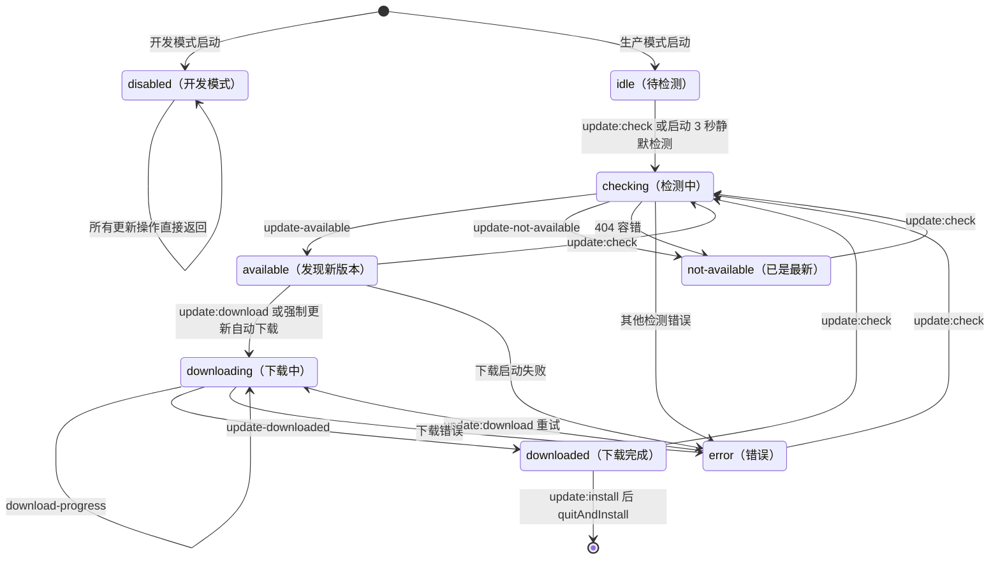
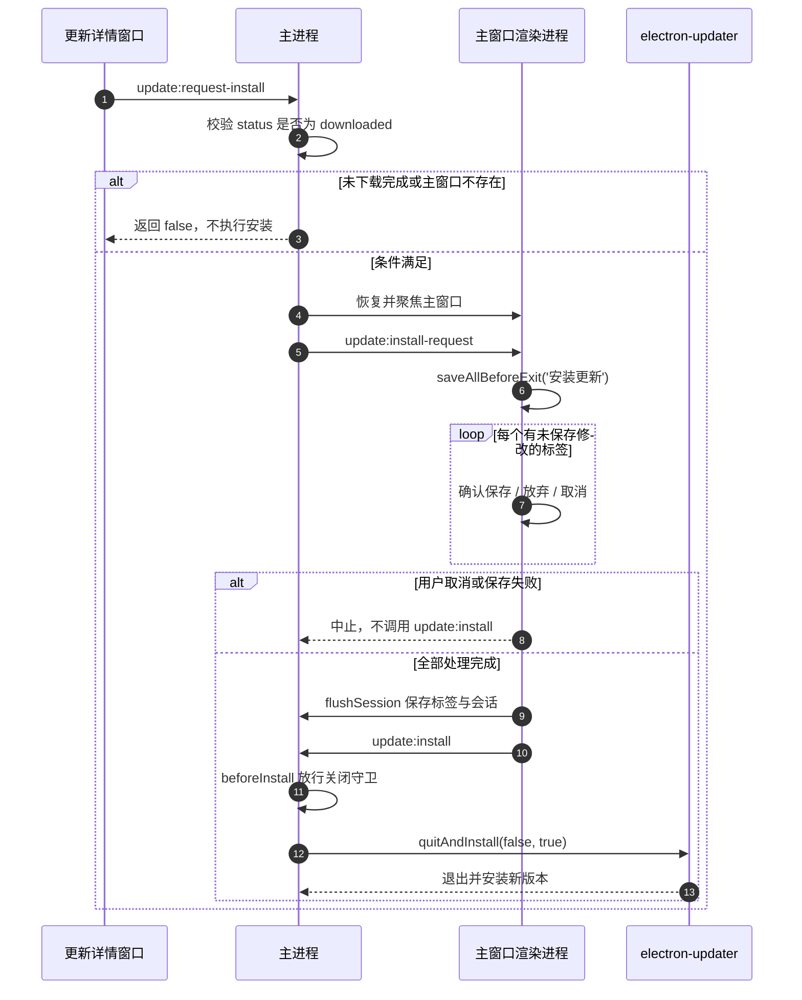

# 自动更新

> 文档定位：说明 MarkIt 1.4.1 的自动更新实现，包括更新通道、状态机、主进程与渲染层职责、强制更新、404 容错、下载安装流程、两个窗口的协作方式以及故障排查。面向维护更新功能与发版流程的开发者；发版操作本身见 [`docs/github-release.md`](./github-release.md)，构建打包细节见 [`docs/构建与发布.md`](./构建与发布.md)。

## 1. 依赖与更新通道

| 项目             | 现值                                                                          | 位置                                                                                               |
| ---------------- | ----------------------------------------------------------------------------- | -------------------------------------------------------------------------------------------------- |
| 更新库           | `electron-updater` `^6.3.9`                                                   | [`package.json`](../package.json)                                                                  |
| Provider         | `generic`                                                                     | [`src/main/updater.ts`](../src/main/updater.ts)、[`electron-builder.yml`](../electron-builder.yml) |
| 平台基址         | `https://appcenter.witice.top`                                                | 同上                                                                                               |
| appKey           | `ah_q100pquj6kxxj9at`（可公开分发）                                           | 同上                                                                                               |
| 通道             | `stable`                                                                      | 同上                                                                                               |
| Feed URL         | `https://appcenter.witice.top/api/update/ah_q100pquj6kxxj9at/stable/electron` | 同上                                                                                               |
| 开发期配置       | [`dev-app-update.yml`](../dev-app-update.yml)                                 | 仓库根目录                                                                                         |
| 开发期缓存目录   | `mark-it-ev-updater`                                                          | [`dev-app-update.yml`](../dev-app-update.yml)                                                      |
| 打包产物缓存目录 | `mark-it-updater`                                                             | 打包后 `resources/app-update.yml`（electron-builder 生成）                                         |

说明：

1. `electron-builder.yml` 的 `publish` 段用于生成安装包内的 `app-update.yml`；`src/main/updater.ts` 在运行时再次调用 `autoUpdater.setFeedURL({ provider: 'generic', url: FEED_URL })`，两处必须保持一致。
2. `dev-app-update.yml` 只服务开发/调试场景，其中 `updaterCacheDirName` 为 `mark-it-ev-updater`；正式安装包的 `app-update.yml` 未显式配置同名项，electron-builder 按应用名生成 `mark-it-updater`。两者指向不同的缓存目录，排查「下载进度异常/缓存残留」时不要混淆。
3. appKey 仅用于识别应用，平台更新检测本身零密钥；发版用的签名密钥与账号密码绝不能进入客户端（见第 11 节）。

## 2. 状态模型

更新状态集中定义在 [`src/shared/update-types.ts`](../src/shared/update-types.ts)，由主进程维护单一实例，渲染进程只做镜像。

| 状态            | 含义                                |
| --------------- | ----------------------------------- |
| `disabled`      | 开发模式下不检测更新                |
| `idle`          | 已初始化，尚未检测                  |
| `checking`      | 正在检测                            |
| `available`     | 发现新版本，尚未下载                |
| `not-available` | 当前已是最新版本（含平台 404 容错） |
| `downloading`   | 正在下载，`progress` 有效           |
| `downloaded`    | 下载完成，可重启安装                |
| `error`         | 检测或下载失败，`error` 为错误信息  |

共 8 个状态（含 `disabled`）。



触发事件与代码入口：

| 事件         | 入口                                                           | 结果                              |
| ------------ | -------------------------------------------------------------- | --------------------------------- |
| 启动静默检测 | `initAutoUpdater` 中 `setTimeout(..., 3000)`                   | `idle → checking`                 |
| 手动检测     | `update:check` / `useUpdateStore.check()`                      | 清除「跳过」记录后 `checking`     |
| 发现新版本   | `autoUpdater.on('update-available')`                           | `available`，强制更新立即下载     |
| 无新版本     | `autoUpdater.on('update-not-available')`                       | `not-available`                   |
| 下载进度     | `autoUpdater.on('download-progress')`                          | `downloading` + `progress`        |
| 下载完成     | `autoUpdater.on('update-downloaded')`                          | `downloaded`                      |
| 错误         | `autoUpdater.on('error')` / `check()`、`download()` 的 `catch` | `error`；404 转为 `not-available` |
| 安装         | `update:install`                                               | `quitAndInstall(false, true)`     |

## 3. 主进程实现

实现文件：[`src/main/updater.ts`](../src/main/updater.ts)；在 [`src/main/index.ts`](../src/main/index.ts) 的 `app.whenReady()` 内、主窗口创建后调用 `initAutoUpdater`。

1. **状态单例**：模块级 `state: UpdateState`，初始 `{ status: 'idle', currentVersion: '0.0.0', forceUpdate: false }`。初始化时写入 `currentVersion = app.getVersion()`，并按 `is.dev` 将状态置为 `disabled`（开发）或 `idle`（生产）。
2. **统一写入与广播**：所有状态变化都经 `setState(patch)` 合并后调用 `broadcast()`，遍历 `BrowserWindow.getAllWindows()`，向未销毁窗口的 `webContents.send('update:state', state)`。主窗口与独立更新窗口都能收到同一份状态。
3. **feed 配置**：`autoUpdater.setFeedURL({ provider: 'generic', url: FEED_URL })`。
4. **下载策略**：`autoUpdater.autoDownload = false`，发现版本后由用户点击下载；强制更新是唯一例外，由主进程自动调用 `downloadUpdate()`。
5. **退出安装策略**：`autoUpdater.autoInstallOnAppQuit = true`，用户正常退出应用时也会安装已下载的更新。
6. **启动静默检测**：仅生产模式在初始化 3 秒后调用一次 `checkForUpdates()`，避免与首屏渲染、会话恢复抢资源。
7. **开发模式**：`status = 'disabled'`，`checkForUpdates()` 直接返回；不执行启动静默检测。开发期可在设置页确认状态，但不会真正请求更新端点。
8. **幂等初始化**：`initialized` 标志保证 `initAutoUpdater` 只生效一次。

### 3.1 IPC 与 preload 契约

| 通道                     | 方向       | 作用                                   |
| ------------------------ | ---------- | -------------------------------------- |
| `update:get-state`       | invoke     | 读取当前状态快照                       |
| `update:check`           | invoke     | 检测更新，返回最新状态                 |
| `update:download`        | invoke     | 下载更新，返回状态                     |
| `update:install`         | invoke     | 放行关闭守卫并退出安装，返回是否受理   |
| `update:open-window`     | invoke     | 打开或聚焦独立更新详情窗口             |
| `update:close-window`    | send       | 更新窗口关闭自身（不阻塞、不等待回复） |
| `update:request-install` | invoke     | 更新窗口请求主窗口处理未保存内容后安装 |
| `update:state`           | 主进程推送 | 状态变化广播到所有窗口                 |
| `update:install-request` | 主进程推送 | 要求主窗口执行安装前处理               |

preload 暴露面见 [`src/preload/index.ts`](../src/preload/index.ts) 的 `api.update`，类型契约由 [`src/preload/index.d.ts`](../src/preload/index.d.ts) 的 `ExposedAPI` 约束。

## 4. 强制更新

平台约定在版本的 `releaseNotes` 首行前置 `[force]` 标记。主进程 `extractReleaseNotes(info)` 负责解析：

1. `releaseNotes` 为字符串时直接使用；为数组时按 `v{version}\n{note}` 拼接，条目之间空行分隔。
2. 仅当文本**以** `[force]` 开头时判定为强制更新；随后剔除该标记，并移除紧随其后的一个换行（`\r?\n`），最终 `trim()`。
3. `update-available` 时写入 `forceUpdate: true`，并立即调用 `downloadUpdate()`，用户无需先点「下载」。
4. UI 限制：
   - 主窗口提示卡片隐藏「跳过」按钮，显示「重要」徽标；
   - 更新详情窗口隐藏「稍后」按钮，显示「重要更新」徽标；
   - 渲染层 `dismiss()` 在 `forceUpdate && hasUpdate` 时直接返回，不允许关闭主窗口提示卡片。更新详情窗口标题栏的关闭按钮仍可关闭窗口，但下载与安装状态由主进程保持。
5. 强制标记由发版侧写入：`apphub.mjs create-version --force` 或 `update-version --force true`（见 [`docs/github-release.md`](./github-release.md)）。

## 5. 404 容错

平台在「某个平台尚未发布任何版本」时，electron 更新端点会返回 404。主进程用 `isNotFoundError(error)` 判定：

```ts
function isNotFoundError(error: unknown): boolean {
  const message = error instanceof Error ? error.message : String(error)
  return message.includes('404') || message.toLowerCase().includes('cannot find latest')
}
```

两处兜底：

1. `checkForUpdates()` 的 `try/catch`：捕获后把状态置为 `not-available`，并清空 `error`。
2. `autoUpdater.on('error')`：同样把 404 转为 `not-available`，而不是展示失败。

这样首装或某平台暂未发版时，界面显示「当前已是最新版本」，不会出现红色错误提示。

## 6. 下载与安装

### 6.1 下载

`update:download` 对应 `downloadUpdate()`：

- 正在 `checking` 或 `downloading` 时直接返回当前状态，避免重复触发；
- 仅允许在 `available` 或 `error` 状态下发起，其余状态忽略；
- 检测与下载紧邻发生，下载地址仍在平台 2 小时有效期内；失败后重试会重新下载；
- `download-progress` 持续写入 `progress`（百分比、速度、已传输、总量）并广播；
- 下载异常写入 `error`。

### 6.2 安装

`update:install` 对应 `installUpdate()`：

1. 仅在 `downloaded` 状态受理，否则返回 `false`。
2. 调用 `beforeInstall?.()`。该回调由 [`src/main/index.ts`](../src/main/index.ts) 注入，作用是把 `allowClose` 置为 `true`，放行主窗口的关闭守卫，避免安装器退出应用时被「未保存内容确认」卡住。
3. `setImmediate(() => autoUpdater.quitAndInstall(false, true))`：`isSilent = false`，安装后重新启动应用（`isForceRunAfter = true`）。
4. 因为 `autoInstallOnAppQuit = true`，即使用户没有点「立即安装」，正常退出时也会安装已下载版本。

安装前保存未保存内容与会话由渲染进程负责（见第 7 节），主进程只负责放行关闭与退出安装。

## 7. 两个窗口协作

更新相关 UI 分布在三处：

| 位置                                                                                            | 职责                                                                          |
| ----------------------------------------------------------------------------------------------- | ----------------------------------------------------------------------------- |
| 主窗口右下角 [`UpdateNotice.vue`](../src/renderer/src/components/update/UpdateNotice.vue)       | 轻量提示「发现新版本」，提供「跳过 / 查看」；不展示更新说明与下载进度         |
| 主窗口设置页 [`SettingsDialog.vue`](../src/renderer/src/components/settings/SettingsDialog.vue) | 展示当前版本、更新状态、更新说明，并提供「检查 / 下载 / 重启安装 / 重试」按钮 |
| 独立更新详情窗口 [`UpdateWindow.vue`](../src/renderer/src/update/UpdateWindow.vue)              | 展示版本、更新内容、下载进度与速度，提供下载 / 立即重启安装 / 稍后            |

### 7.1 独立更新详情窗口

主进程 `openUpdateWindow()`：

- 尺寸 `560 × 680`，最小 `460 × 520`，`frame: false`、`autoHideMenuBar: true`、`center: true`、背景 `#1c1c27`、标题 `MarkIt 更新`。
- 单实例：已有窗口未销毁时，按需 `restore()`、`show()`、`focus()`，不会重复创建。
- 开发模式加载 `${ELECTRON_RENDERER_URL}/update.html`；打包后加载 `../renderer/update.html`。
- 渲染入口为 [`src/renderer/src/update/main.ts`](../src/renderer/src/update/main.ts)，挂载 `UpdateWindow.vue`；窗口自己的关闭按钮通过 `update:close-window` 让主进程关闭发送者窗口。

### 7.2 完整安装时序



从设置页安装时，主窗口直接执行同一套前置处理：`saveAllBeforeExit('安装更新')`（逐个确认所有 `isModified` 标签 → 必要时保存 → `flushSession()`）→ `update.install()`，不经过更新窗口转发。

## 8. 渲染层 store

实现文件：[`src/renderer/src/stores/update.ts`](../src/renderer/src/stores/update.ts)。

| 成员               | 类型               | 说明                                                                      |
| ------------------ | ------------------ | ------------------------------------------------------------------------- |
| `state`            | `Ref<UpdateState>` | 主进程状态的镜像，初值 `idle`、空版本号                                   |
| `showNotice`       | `Ref<boolean>`     | 是否展示右下角提示卡片；设置页不依赖此值                                  |
| `isBusy`           | `Computed`         | `checking` 或 `downloading`                                               |
| `hasUpdate`        | `Computed`         | `available`、`downloading`、`downloaded`                                  |
| `init()`           | 方法               | 先订阅 `update:state`，再拉取 `update:get-state`；用 `initialized` 防重复 |
| `check()`          | 方法               | 清除 `dismissedVersion`，调用 `update:check`，有更新时强制显示提示        |
| `download()`       | 方法               | 调用 `update:download` 并应用返回状态                                     |
| `install()`        | 方法               | 调用 `update:install`，返回布尔值                                         |
| `openWindow()`     | 方法               | 打开/聚焦更新详情窗口                                                     |
| `requestInstall()` | 方法               | 供更新详情窗口请求主窗口安装                                              |
| `dismiss()`        | 方法               | 记录跳过的版本并隐藏提示                                                  |

规则细节：

1. **`apply(next)`**：先整体替换状态；当状态为 `available` / `downloading` / `downloaded`，且 `latestVersion !== dismissedVersion` 时把 `showNotice` 置为 `true`。这样下载进度事件持续刷新状态时，已被跳过的版本不会反复弹卡。
2. **`dismissedVersion`**：模块内 `ref`，不持久化，重启应用后清空；只记住当前会话中跳过的版本。
3. **`dismiss()`**：强制更新且存在更新时直接返回；否则记录 `latestVersion`（可能为空）并隐藏提示。
4. **手动检测**：`check()` 先清空 `dismissedVersion`，因此手动检查发现同一版本会重新提示；返回状态为 `available` 或 `downloading` 时显式置 `showNotice = true`（`downloaded` 不在显式列表内，但会由随后的状态广播按 `apply` 规则处理）。
5. **初始化顺序**：先注册 `onState` 再 `getState()`，避免拉取快照与后续广播之间的状态丢失。

## 9. 版本展示与更新说明渲染

### 9.1 展示位置

| 位置           | 展示内容                                                                                               |
| -------------- | ------------------------------------------------------------------------------------------------------ |
| 右下角提示卡片 | `发现新版本 v{latestVersion}`、`当前版本 v{currentVersion}`；强制更新额外显示「重要」                  |
| 设置页「关于」 | `MarkIt`、`v{currentVersion}`、状态文案、操作按钮、更新说明（有更新时）                                |
| 更新详情窗口   | `发现新版本 v{latestVersion}`（无版本时显示「软件更新」）、当前版本、更新内容、下载进度/速度、错误信息 |

设置页状态文案与按钮：

| 状态            | 状态文案              | 按钮             |
| --------------- | --------------------- | ---------------- |
| `disabled`      | 开发模式，不检测更新  | 检查更新（禁用） |
| `idle`          | 尚未检测              | 检查更新         |
| `checking`      | 正在检查更新…         | 处理中…（禁用）  |
| `not-available` | 已是最新版本          | 检查更新         |
| `available`     | 发现新版本 vX         | 下载更新         |
| `downloading`   | 正在下载 N%           | 处理中…（禁用）  |
| `downloaded`    | vX 已下载，重启后安装 | 重启安装         |
| `error`         | 更新检查失败：…       | 重试             |

更新详情窗口按钮：

| 条件                   | 按钮                                       |
| ---------------------- | ------------------------------------------ |
| `available` 或 `error` | 「下载更新」；`error` 时文案为「重新下载」 |
| `downloading`          | 「正在下载…」（禁用）                      |
| `downloaded`           | 「立即重启安装」                           |
| 非强制更新             | 额外显示「稍后」                           |

### 9.2 更新说明的渲染方式

- 更新说明是**纯文本**，不解析 Markdown、不注入 HTML。更新窗口使用 `{{ notes }}` 插值，设置页同样使用 `{{ update.state.notes }}`。
- 通过 CSS `white-space: pre-wrap` 保留换行，`word-break: break-word` 处理长行；更新窗口的说明区最大高度 320px、可滚动，设置页最大高度 120px、可滚动。
- 数组形式的 `releaseNotes` 已在主进程归一化为 `v{version}\n{note}` 并以空行分隔，因此渲染层只需处理一段文本。
- 说明为空时，更新窗口显示「该版本未提供更新说明。」；设置页不渲染说明块。

## 10. 故障排查

| 现象                                   | 可能原因                                                              | 处理                                                                          |
| -------------------------------------- | --------------------------------------------------------------------- | ----------------------------------------------------------------------------- |
| 设置页一直显示「开发模式，不检测更新」 | 以 `npm run dev` 启动，`is.dev` 为真                                  | 用打包产物验证；开发模式不会请求更新端点                                      |
| 首装或某平台一直「已是最新版本」       | 该平台尚无已发布版本，端点返回 404，被容错为 `not-available`          | 用 `apphub.mjs verify --platform ...` 确认版本已发布                          |
| 检测报 401 / 签名失败                  | 发版侧账号密码或 `APPHUB_SIGN_SECRET` 错误                            | 检查 CI Secrets 或本地 `.apphub-release.json`；这与客户端 appKey 无关         |
| 下载地址 404 / 下载中断                | 平台包被撤回、网络代理拦截、下载地址超过有效期                        | 重新检测后再下载；检查网络与平台版本状态                                      |
| 有新版本但客户端不提示                 | 版本号未递增、通道不一致、appId 被改动                                | 核对版本号、`stable` 通道、`com.harley.markit` 与 appKey                      |
| 强制更新未生效                         | `[force]` 不在 `releaseNotes` 首行，或发版时未带 `--force`            | 检查 `create-version --force` / `update-version --force true`，并确认首行格式 |
| 更新窗口空白                           | 打包产物缺少 `update.html`，或开发地址未包含 `/update.html`           | 检查 renderer 的两个 rollup input 是否都在                                    |
| 点安装后应用不退出                     | 主窗口关闭守卫未放行                                                  | 确认 `beforeInstall` 已注入并执行，且状态为 `downloaded`                      |
| 安装后仍是旧版本                       | 安装包版本未变、更新被平台判为同版本、macOS 未签名                    | 递增版本号；macOS 未签名时只能手动安装                                        |
| 缓存异常/磁盘占用                      | 开发缓存 `mark-it-ev-updater` 与正式缓存 `mark-it-updater` 混用或残留 | 退出应用后清理对应缓存目录再重试                                              |

平台限制：

- **macOS**：当前未配置 Apple Developer 证书与公证（`notarize: false`），Squirrel.Mac 不会执行自动更新，只能手动安装。
- **Linux**：仅 AppImage 支持自动更新；deb 供手动安装。
- **Windows**：未配置代码签名，安装时可能出现 SmartScreen 提示，但不影响自动更新与 blockmap 差分。

## 11. 安全约束

1. **appKey 可公开**：`ah_q100pquj6kxxj9at` 仅用于平台识别应用，更新检测零密钥，可以随客户端分发。
2. **签名密钥不可入包**：`APPHUB_SIGN_SECRET`、账号密码只存在于 CI Secrets 或被 gitignore 的本地 `.apphub-release.json`。
3. **打包排除**：[`electron-builder.yml`](../electron-builder.yml) 的 `files` 排除了 `.apphub-release*.json`、`scripts`、`docs` 等；CI 在构建后还会扫描 `app.asar`，命中 `apphub-release` 或 `signSecret` 直接阻断发布。
4. **最小暴露面**：渲染进程只能通过 preload 的 `window.api.update` 操作更新，不得直接访问 `electron` 或文件系统。
5. **安装前确认**：安装会重启应用，必须先在主窗口完成未保存内容确认与会话落盘，不能由更新窗口直接 `quitAndInstall`。

## 12. 相关文件

| 文件                                                                                                                    | 作用                                                       |
| ----------------------------------------------------------------------------------------------------------------------- | ---------------------------------------------------------- |
| [`src/main/updater.ts`](../src/main/updater.ts)                                                                         | 更新状态单例、feed 配置、事件绑定、IPC、更新窗口与安装入口 |
| [`src/shared/update-types.ts`](../src/shared/update-types.ts)                                                           | `UpdateStatus`、`UpdateState`、`UpdateProgress` 纯类型     |
| [`src/preload/index.ts`](../src/preload/index.ts)                                                                       | `api.update` 暴露面                                        |
| [`src/preload/index.d.ts`](../src/preload/index.d.ts)                                                                   | `ExposedAPI` 类型契约                                      |
| [`src/renderer/src/stores/update.ts`](../src/renderer/src/stores/update.ts)                                             | 渲染层状态镜像、提示与操作封装                             |
| [`src/renderer/src/components/update/UpdateNotice.vue`](../src/renderer/src/components/update/UpdateNotice.vue)         | 主窗口右下角更新提示                                       |
| [`src/renderer/src/components/settings/SettingsDialog.vue`](../src/renderer/src/components/settings/SettingsDialog.vue) | 设置页版本、状态与操作                                     |
| [`src/renderer/src/update/UpdateWindow.vue`](../src/renderer/src/update/UpdateWindow.vue)                               | 独立更新详情窗口                                           |
| [`src/renderer/src/update/main.ts`](../src/renderer/src/update/main.ts)                                                 | 更新窗口入口                                               |
| [`src/renderer/update.html`](../src/renderer/update.html)                                                               | 更新窗口 HTML 入口                                         |
| [`src/renderer/src/App.vue`](../src/renderer/src/App.vue)                                                               | 安装请求处理、未保存内容确认与会话落盘                     |
| [`dev-app-update.yml`](../dev-app-update.yml)                                                                           | 开发期更新配置与缓存目录                                   |
| [`electron-builder.yml`](../electron-builder.yml)                                                                       | 打包发布配置与凭据排除                                     |
| [`docs/github-release.md`](./github-release.md)                                                                         | 发版流程、Secrets、错误码与操作命令                        |
