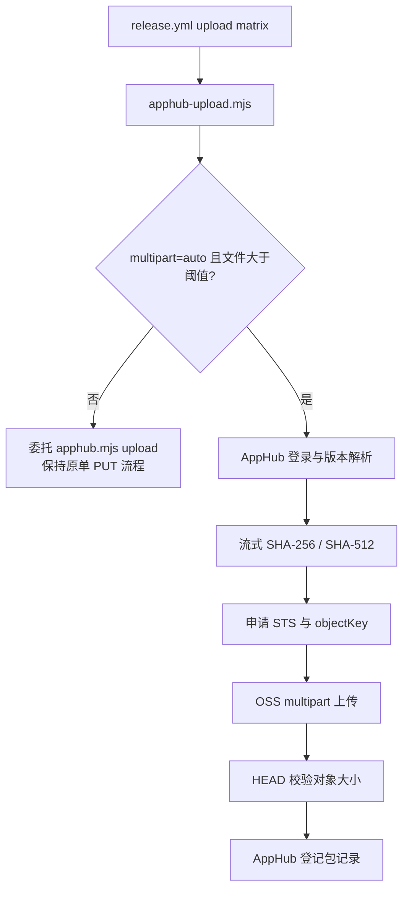

# AppHub OSS 分片上传适配层设计

> **状态：本地实现和自动化测试已完成；真实 Beta STS multipart 权限及 >500 MB macOS zip 验证仍待完成。**
>
> 文档定位：在不修改会自更新的 `scripts/release/apphub.mjs` 的前提下，为大安装包增加 OSS multipart（分片上传）能力。
>
> 上游优先原则与整体优化背景见 [AppHub 发布上传链路优化设计](./AppHub发布上传链路优化设计.md)。

## 1. 改造边界

AppHub CLI 当前 `upload` 子命令把哈希、STS 申请、OSS 整文件 `PUT` 和包登记串在一个流程中，并已通过
[`scripts/release/apphub.mjs`](../../scripts/release/apphub.mjs) 导出 `ApphubClient`、`hashFile` 和
`ossPutObject`。这些能力可以在外部脚本中复用，且导入该文件不会启动 CLI 主流程。

上游尚未提供 multipart 参数，因此本仓库新增一个受控适配入口：

| 入口                                | 职责                                                                                                |
| ----------------------------------- | --------------------------------------------------------------------------------------------------- |
| `.github/workflows/release.yml`     | 只负责平台矩阵、产物定位和调用上传入口                                                              |
| `scripts/release/apphub-upload.mjs` | 保持 `apphub.mjs upload` 的命令语义；选择单次上传或分片上传；调用 AppHub 登录、版本解析和包登记接口 |
| `scripts/release/oss-multipart.mjs` | 只处理 OSS 分片计划、签名、并发、重试、进度、完成、中止和对象大小校验                               |

`scripts/release/apphub.mjs` 仍是上游技能快照，不得修改。若上游后续原生支持 multipart，应优先切换到上游参数并删除仓库适配层。

## 2. 传输选择

默认参数：

| 参数             |      默认值 | 可调方式                                   |
| ---------------- | ----------: | ------------------------------------------ |
| 启用阈值         |      64 MiB | `APPHUB_MULTIPART_THRESHOLD_BYTES`         |
| 分片大小         |      16 MiB | `APPHUB_MULTIPART_PART_SIZE_BYTES`         |
| 并发度           |           4 | `APPHUB_MULTIPART_CONCURRENCY`             |
| 单分片重试       |        3 次 | `APPHUB_MULTIPART_RETRIES`                 |
| 单分片无进展超时 |       90 秒 | `APPHUB_MULTIPART_PART_TIMEOUT_MS`         |
| 进度间隔         | 5% 或 15 秒 | `APPHUB_MULTIPART_PROGRESS_INTERVAL_MS`    |
| 模式开关         |      `auto` | workflow 输入或 `--multipart auto` / `off` |

小文件、`--multipart off` 或发生兼容问题时，直接委托现有 `apphub.mjs upload`，确保哈希、STS、整文件
`PUT` 和包登记保持原行为。大文件模式不自动在权限错误后降级，避免把 STS 权限问题伪装成成功；运维人员应明确选择 `off` 后重跑。

## 3. OSS 协议

分片流程使用平台签发的同一个 STS 凭证和 `objectKey`：

1. `POST /{objectKey}?uploads` 初始化会话，取得 `UploadId`。
2. 使用 1 起始的 `partNumber` 并发执行 `PUT /{objectKey}?partNumber=N&uploadId=...`。
3. 每个分片按闭区间读取文件，最后一片可以为短分片；全部分片大小仍需满足 OSS 最小分片和最多 10,000 片限制。
4. 全部成功后按 `partNumber` 升序调用 `POST /{objectKey}?uploadId=...` 完成合并。
5. 任一不可恢复错误会尽力调用 `DELETE /{objectKey}?uploadId=...` 中止未完成会话。
6. Complete 成功后，如 STS 允许读取对象，使用 `HEAD` 校验 `Content-Length`；若返回 403，说明凭证仅有
   上传权限，此时以“所有分片成功且 Complete 成功”为完成条件继续登记，并在日志中明确提示跳过了只读复核。
   其他 HEAD 错误仍按失败处理。

签名继续使用 OSS V1 Header 签名（HMAC-SHA1）和 `x-oss-security-token`。CanonicalizedResource
使用未编码的 `/{bucket}/{objectKey}`，并按字典序附带 `uploads`、`partNumber`、`uploadId` 子资源；
请求路径只对 objectKey 的每个路径段做 URL 编码。初始化、上传分片、完成和中止必须使用同一套规则。

## 4. 重试与失败恢复

- 每个分片独立重试，成功分片不会因其他分片失败而重传。
- 网络错误、超时、HTTP 408、429 和 5xx 可重试；其余 4xx 以及协议字段缺失不盲目重试。
- 每次重试使用指数退避并加入随机抖动，默认最多 3 次重试。
- 同一时刻最多运行配置数量的分片；某个分片最终失败后不再调度新分片，等待已发出的请求结束后中止会话。
- 首版只支持单次 job 内的分片重试，不持久化 `uploadId` 或分片列表，**不承诺跨 job 断点续传**。
- 重跑时创建新的 multipart 会话；未完成会话通过 Abort 或 OSS 生命周期规则清理。

## 5. 进度与安全

进度日志只输出平台、传输模式、分片计数、字节数、百分比、平均速度和 ETA。不得输出：

- `securityToken`、`accessKeyId`、`accessKeySecret`；
- `Authorization`、签名串、`uploadId` 以外的临时凭证内容；
- AppHub 账号密码、JWT 或签名密钥。

OSS 错误只提取安全的 `Code` / `Message` 和 HTTP 状态，不回显请求头或凭证。AppHub API 仍由
`ApphubClient` 统一处理登录、Bearer JWT、签名与错误响应。

## 6. 兼容性与回退

1. Beta / stable 通道仍由配置文件决定，上传入口不新增 `--channel`。
2. 版本状态仍允许 `draft` / `published`；`--replace` 对已有平台包执行替换，对尚不存在的平台包按新增登记。
3. blockmap 仍按当前文件名和哈希字段登记；只有超过阈值的对象使用 multipart。
4. AppHub 发布、更新检测和 GitHub Release 阶段不变。
5. workflow 提供 `multipart=off` 回退；回退后调用原 CLI，不删除已上传对象，也不改变版本号。
6. 若平台 STS 缺少初始化、UploadPart、Complete 或 Abort 权限，必须阻止包登记，并在真实 Beta 验证后补充最小权限说明。
7. 若平台 STS 未授予对象 HEAD 读取权限，只读大小复核可降级为警告；但上传分片或 Complete 的任何失败都不得降级。

## 7. 测试与验收

本地自动化测试已覆盖：

- 分片边界、最后短分片和超出部分数量限制；
- 乱序完成后按 `partNumber` 生成 Complete XML；
- 仅失败分片重试，其他分片只上传一次；
- 不可恢复失败时 Abort，不登记包记录；
- 小文件与 `multipart=off` 走单次上传分支；
- CanonicalizedResource 包含正确的 `uploads` / `partNumber` / `uploadId` 子资源；
- 进度与错误输出不包含 STS 凭证、AccessKey、Authorization 或签名。

真实 Beta 验收仍需确认，完成前不得把本适配层标记为已上线：

- STS 对四个 multipart 操作的权限与凭证有效期；
- 超过 500 MB 的 macOS universal zip 能完成、合并并通过大小校验（STS 无读取权限时记录降级警告）；
- AppHub 包登记、发布和三平台 `verify` 不受影响；
- 失败后重跑同一版本和 `replace` 流程符合现有规则。
