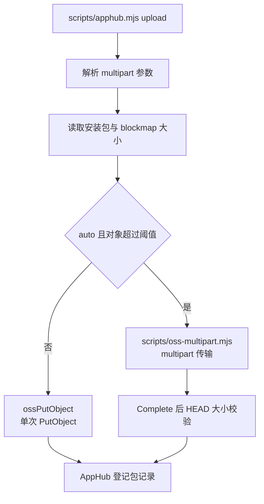
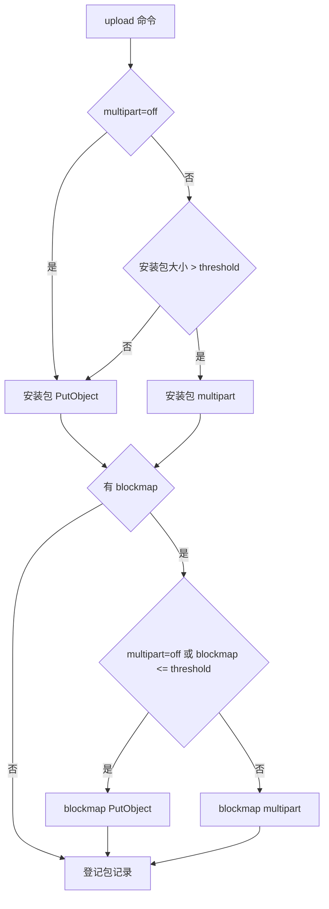
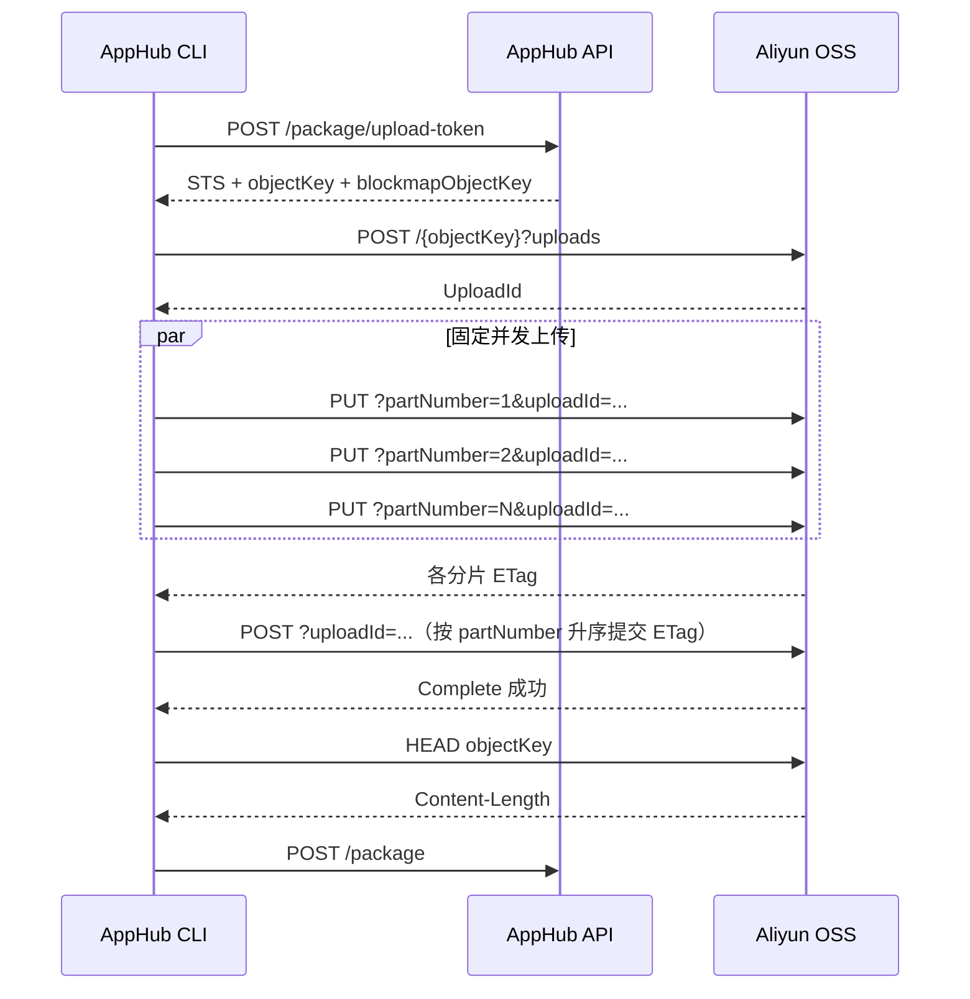

# AppHub skill OSS 分片上传上游改造说明

> **文档用途**：提交给 AppHub skill（`apphub-release`）上游维护者，作为把 OSS multipart 上传能力合并进原生 `scripts/apphub.mjs upload` 的需求与实现说明。
>
> **目标结论**：原 `apphub.mjs upload` 可以统一复用同一套分片能力。正确做法是让上游 CLI 原生支持 `--multipart auto|off`，并把传输实现抽成独立模块；仅让调用方改用一个外部适配脚本，不能使 skill 本身获得分片能力。
>
> **当前状态**：MarkIt 仓库适配层已完成自动化测试，并通过 `1.6.0-beta.9` 真实 Beta 验证；超过 500 MiB 样本与 Abort 失败路径仍待验证。AppHub skill 上游尚未合并，原生入口仍需在合并后重跑真实验收。
>
> **最后核对**：2026-11-11。

## 1. 改造背景

AppHub 当前 `upload` 由调用方直接从 runner 向阿里云 OSS 上传整文件，主流程为：

1. 流式计算 SHA-256 / SHA-512。
2. 向 AppHub 申请 STS 凭证、对象键和 blockmap 对象键。
3. 使用单个 `PutObject` 请求上传安装包。
4. 如有 blockmap，再使用单个 `PutObject` 上传 blockmap。
5. 两个对象都成功后，登记 AppHub 包记录。

该流程适合小文件，但大安装包存在以下问题：

- 单连接吞吐容易受跨境链路、丢包和高延迟限制。
- 整文件只有一个请求，无法按分片并行，也无法只重试失败分片。
- 请求没有可区分的字节进度、速度和 ETA；运行缓慢与连接停滞不易判断。
- 单个连接长期无进展时，通常只能等待整个 job 超时。

MarkIt 的 macOS universal 产物需要按 500 MB 量级规划；当前 Beta 的实际 zip 最大样本约 245 MiB，更大边界仍待专项验证。只增加三平台并行 job 可以缩短总墙钟时间，但不能解决单文件传输效率问题。因此需要把 OSS multipart 作为 AppHub `upload` 的原生能力。

## 2. 改造目标与非目标

### 2.1 目标

1. `apphub.mjs upload` 原生支持 `--multipart auto|off`，默认 `auto`。
2. 超过阈值的安装包或 blockmap 使用 OSS multipart；小文件继续使用单次 `PutObject`。
3. 支持固定并发、分片级重试、单分片无进展超时、字节进度、速度和 ETA。
4. 保持 AppHub 登录、签名、版本解析、STS、包登记、发布和验证接口不变。
5. 安装包和 blockmap 全部传输及必要校验成功后，才登记包记录。
6. `off` 是显式兼容回退，不允许 multipart 失败后自动降级成单次上传。
7. 上游 skill 自更新后，调用方仍使用同一入口，无需长期维护替代 CLI 的适配脚本。

### 2.2 非目标

- 不改变 AppHub 服务端 API、STS 签发协议或包登记字段。
- 不改变安装包格式、blockmap 格式、通道和版本规则。
- 不通过 AppHub 服务端中转安装包流量。
- 不实现跨 job 断点续传；第一版只保证单次 job 内的分片重试。
- 不持久化 `uploadId`、已完成分片和 ETag。
- 不删除已经成功上传的对象来模拟事务回滚。
- 不为 multipart 引入第三方 OSS SDK；参考实现只使用 Node.js 内置模块。

## 3. 已有行为与参考实现

当前上游核心行为等价于：

```text
stat(file)
  -> hashFile(file)
  -> POST /package/upload-token
  -> ossPutObject(credential, objectKey, file)
  -> ossPutObject(credential, blockmapObjectKey, blockmap)
  -> POST /package
```

MarkIt 当前没有直接改写本地 `scripts/release/apphub.mjs`，因为该文件是会被 skill 自更新覆盖的快照。仓库暂时使用以下分层：

| 模块                | 职责                                                             |
| ------------------- | ---------------------------------------------------------------- |
| `apphub.mjs`        | AppHub 原生 CLI、认证、版本、STS、单次上传和包登记               |
| `apphub-upload.mjs` | 临时适配入口；小文件或 `multipart=off` 时委托原 CLI              |
| `oss-multipart.mjs` | OSS 分片计划、签名、并发、重试、进度、Complete、Abort 和大小校验 |

这只是上游支持前的兼容方案。上游合并后，`apphub.mjs upload` 应直接具备这些能力，外部适配入口可保留为短期别名，随后退役。

## 4. 推荐上游架构

建议保持 CLI 入口和业务接口稳定，只在传输层拆分模块：



推荐模块边界：

- `scripts/apphub.mjs`：保留原有命令、认证、API 客户端和包登记语义；仅增加参数解析与传输选择。
- `scripts/oss-multipart.mjs`：只负责 OSS 传输，不读取 AppHub 配置，不登录，不登记包。
- 单次上传函数继续保留，作为小文件和 `off` 的稳定路径。

`apphub.mjs` 需要新增对 `scripts/oss-multipart.mjs` 的同目录 import。两者必须由 skill manifest 一起分发，否则自更新后的 CLI 会因缺少模块而无法启动。

## 5. CLI 与环境变量契约

### 5.1 推荐命令

```bash
node scripts/apphub.mjs upload \
  --config .apphub-release.ci.json \
  --version 1.6.0 \
  --platform macos \
  --arch universal \
  --file dist/mark-it-1.6.0-universal.zip \
  --blockmap dist/mark-it-1.6.0-universal.zip.blockmap \
  --multipart auto \
  --part-size 16MiB \
  --concurrency 4 \
  --retry 3
```

建议最终公开以下选项：

| 选项                  | 取值             |   默认值 | 说明                                        |
| --------------------- | ---------------- | -------: | ------------------------------------------- |
| `--multipart`         | `auto` / `off`   |   `auto` | `auto` 按对象大小决定；`off` 全部走单次 PUT |
| `--threshold`         | 字节数或 `64MiB` | `64 MiB` | 严格大于阈值才启用 multipart                |
| `--part-size`         | 字节数或 `16MiB` | `16 MiB` | 普通分片大小，最后一片可短                  |
| `--concurrency`       | 正整数           |      `4` | 同时进行的 UploadPart 数                    |
| `--retry`             | 非负整数         |      `3` | 单分片最大重试次数，不含首次尝试            |
| `--part-timeout`      | 毫秒或 `90s`     |   `90 s` | 单分片无进展超时                            |
| `--progress-interval` | 毫秒或 `15s`     |   `15 s` | 无新百分比时的最长静默间隔                  |

若上游首版希望减少 CLI 表面，可只公开 `--multipart`，但必须同时稳定支持以下环境变量，供 CI 调整：

| 环境变量                                |     默认值 |
| --------------------------------------- | ---------: |
| `APPHUB_MULTIPART`                      |     `auto` |
| `APPHUB_MULTIPART_THRESHOLD_BYTES`      | `67108864` |
| `APPHUB_MULTIPART_PART_SIZE_BYTES`      | `16777216` |
| `APPHUB_MULTIPART_CONCURRENCY`          |        `4` |
| `APPHUB_MULTIPART_RETRIES`              |        `3` |
| `APPHUB_MULTIPART_PART_TIMEOUT_MS`      |    `90000` |
| `APPHUB_MULTIPART_PROGRESS_INTERVAL_MS` |    `15000` |

参数优先级统一为：**CLI 参数 > 环境变量 > 默认值**。布尔值、数字和带单位大小必须严格校验；空字符串按未设置处理，非法值直接失败，不能静默套用默认值。

### 5.2 兼容语义

- 不传新参数时默认 `auto`，以让现有调用方直接获得大文件提效。
- 小文件使用原单 PUT，输出和行为保持兼容。
- `--multipart off` 对整个 upload 命令生效，安装包和 blockmap 都走单次 PUT。
- `auto` 模式下按每个对象独立判断；大安装包和较小的 blockmap 可以分别使用 multipart 和单次 PUT。
- 阈值为 `0` 时可强制所有非空对象走 multipart，便于测试；空文件不能走 multipart。
- `auto` 发生权限、初始化、UploadPart 或 Complete 失败时直接失败，不自动切换到 `off`。运维人员确认兼容问题后再显式重跑 `off`。

## 6. 传输选择流程



安装包与 blockmap 必须分别成功。任一对象失败时，不得调用包登记接口。

## 7. OSS multipart 协议实现

### 7.1 请求序列



### 7.2 分片计划

- `partNumber` 从 1 开始。
- 每片使用闭区间 `[start, end]` 和流式 `createReadStream`，不整文件读入内存。
- 普通分片大小默认 16 MiB；最后一片允许小于分片大小。
- 分片数不得超过 OSS 上限 10,000。
- 普通分片不得小于 OSS 最小分片限制 100 KiB。
- 建议同时校验 OSS 的单分片大小和对象总大小边界。
- 文件在哈希计算后、上传完成前发生变化时，当前参考实现未重新核对；上游可在上传前记录 size / mtime，并在完成后增加一致性检查。

### 7.3 签名

继续使用现有 STS 凭证、OSS V1 Header 签名和 `x-oss-security-token` 请求头。

必须区分两类字符串：

- **CanonicalizedResource** 使用未编码的 `/{bucket}/{objectKey}`，并按字典序附带参与签名的子资源，例如 `uploads`、`partNumber`、`uploadId`。
- **HTTP 请求路径**只对 objectKey 的每个路径段做 URL 编码，不能把编码后的值用于 CanonicalizedResource。

子资源示例：

| 操作     | Method   | 子资源                         |
| -------- | -------- | ------------------------------ |
| 初始化   | `POST`   | `uploads`                      |
| 上传分片 | `PUT`    | `partNumber=N`、`uploadId=...` |
| 完成     | `POST`   | `uploadId=...`                 |
| 中止     | `DELETE` | `uploadId=...`                 |
| 大小校验 | `HEAD`   | 无                             |

### 7.4 Complete 与 Abort

- 所有 UploadPart 成功后再调用 Complete。
- Complete XML 必须按 `partNumber` 升序生成。
- XML 中的 `ETag` 必须转义；提交项不能重复或缺失。
- Complete 成功后才能认为 OSS 对象完整，并允许进入 HEAD 校验和包登记。
- 任一不可恢复分片错误、Complete 错误或大小校验错误，都不能登记包记录。
- 失败后尽力调用 `DELETE ?uploadId=...` 中止会话。
- Abort 返回 `404` / `NoSuchUpload` 可视为已经清理；其他 Abort 错误记录警告，但最终仍抛出原始传输错误。
- 未完成会话还需要 OSS 生命周期规则或服务端清理策略兜底。

## 8. 重试、超时与并发语义

### 8.1 重试

- 每个分片独立重试，已成功分片不因其他分片失败而重传。
- 网络错误、请求超时、HTTP 408、429、5xx，以及 UploadPart 响应缺少 ETag，可重试。
- 其他 4xx、配置错误、协议字段缺失等不可盲目重试。
- `retry=3` 表示首次尝试之外最多重试 3 次，共最多 4 次。
- 重试采用指数退避并加入随机抖动，建议基础延迟 500 ms。
- 一个分片达到最终失败后，不再调度新分片；等待已经发出的请求结束，再终止会话。

### 8.2 超时

- 超时按“单个分片无进展”计算，而不是等待整个文件或整个 job 超时。
- 默认 90 秒无网络活动即终止当前分片并按重试策略处理。
- 终止请求时同时销毁响应、请求和文件流，避免句柄泄漏。
- job 级超时仍需保留，作为所有分片重试和流程异常的总兜底。

### 8.3 并发

- 使用固定数量 worker，默认 4 并发。
- 同时运行的 UploadPart 不超过 `concurrency`。
- 并发只影响分片，不改变 AppHub API 的串行主流程。
- 4 是首轮保守值；应在同一 runner、同一文件和同一时段对比 4 / 8 / 16 并发，根据吞吐和失败率确定最终值。

### 8.4 进度

建议至少输出：

- 平台、文件名、文件大小和传输模式。
- 已完成分片数 / 总片数。
- 已上传字节 / 总字节及百分比。
- 平均速度和 ETA。
- 失败分片号、重试次数和最终错误摘要。

示例：

```text
[macos-universal] multipart 18/33 parts, 281.2/515.6 MiB (54.5%), 2.8 MiB/s, ETA 01:24
```

进度在达到新的 5% 或超过 15 秒静默时输出；参考实现还会在每片完成后强制输出一次。正常运行时不应长时间没有任何日志。

## 9. STS 权限与校验边界

上游需要确认 AppHub 为 STS 签发的最小权限能覆盖：

- Multipart 初始化、UploadPart 和 Complete 所需的写入权限。
- 失败时 AbortMultipartUpload 所需权限。
- 可选的 HEAD / GetObject 读取权限，用于 Complete 后校验对象大小。

权限名称、资源范围和最终最小集合必须在真实 Beta 环境验证，不应仅根据本地 mock 推断。

HEAD 语义必须严格限定：

1. 只有 Complete 成功后才允许 HEAD。
2. HEAD 返回的大小与本地文件大小一致时继续登记。
3. HEAD 返回 403 时，可判定 STS 仅具备上传权限，记录一条明确警告后继续；此时完成依据是“全部分片成功且 Complete 成功”。
4. HEAD 的其他 4xx、5xx、网络错误或大小不一致必须失败，不得登记包记录。
5. UploadPart、Initiate、Complete 的 403 绝不能被当作“仅缺少读取权限”而忽略。

当前参考实现不调用 ListParts，也不支持续传，因此不需要持久化分片列表；若上游后续实现跨 job 恢复，应单独设计 ListParts、凭证刷新和生命周期清理。

## 10. 失败语义与包登记

| 失败阶段                       | 行为                         |
| ------------------------------ | ---------------------------- |
| 本地 stat / blockmap 读取      | 立即失败，不申请 STS         |
| AppHub 登录 / 版本解析         | 立即失败，不传输             |
| upload-token                   | 立即失败，不初始化 multipart |
| Initiate                       | 不调用 Complete，不登记      |
| UploadPart 最终失败            | 尽力 Abort，不登记           |
| Complete 失败                  | 尽力 Abort，不登记           |
| HEAD 大小不一致                | 不登记                       |
| HEAD 非 403 错误               | 不登记                       |
| 安装包或 blockmap 任一传输失败 | 不登记                       |
| 包登记接口失败                 | 命令失败；不自动发布         |

已经成功上传但尚未登记的对象可以暂时成为孤儿对象。不要为了回滚而冒险删除可能已被其他流程使用的对象；由同版本重跑、`replace` 流程和 bucket 生命周期策略处理。

`--multipart off` 只改变传输方式，不改变认证、版本、STS、登记、发布和验证接口。

## 11. 安全与日志要求

日志和错误信息不得包含：

- AppHub 用户名、密码、JWT 或签名密钥。
- `securityToken`、`accessKeyId`、`accessKeySecret`。
- `Authorization`、OSS 签名串或完整请求头。
- 带 token / signature / password 的 URL 查询参数。

OSS 错误只提取安全的 `Code`、`Message` 和 HTTP 状态，并对消息再次脱敏。重试警告、最终错误、Abort 警告和外部异常包装都必须走同一脱敏函数。

额外要求：

- STS 凭证只存在进程内存，不写入文件、artifact、命令行参数或日志。
- 不为调试输出完整 OSS 请求对象。
- 使用私有桶和最小资源范围。
- 同一个 multipart 会话只能对应一个对象。
- 文件流在成功、失败和超时路径都要销毁。

## 12. 向后兼容

上游合并时应保持：

1. 原有 `upload` 参数和必填项不变。
2. 不新增 `--channel`；通道仍由配置决定。
3. 版本状态、`draft` / `published` 和 `--replace` 语义不变。
4. 不改变 `hashFile`、`ossPutObject`、`ApphubClient` 等现有导出；可以新增导出。
5. 小文件路径继续调用原单次上传实现。
6. `off` 路径与改造前行为一致，包括输出和错误处理的主语义。
7. 新版默认 `auto`，但上传完成后登记字段与对象键必须保持原语义。

## 13. 自更新与 manifest 要求

`apphub.mjs` 是 skill 快照，上游必须修改 skill 的规范源码，再通过平台发布新版本。不能只修改某个调用方仓库中的本地副本。

上游发布新版本时：

1. 修改规范源码中的 `scripts/apphub.mjs`。
2. 新增 `scripts/oss-multipart.mjs`。
3. 将两个文件都加入 `apphub-release` manifest。
4. 递增 skill `VERSION`。
5. 为两个文件生成正确的 SHA-256。
6. 保持“全部文件下载并校验后再原子替换，失败回滚”的现有机制。

manifest 的文件路径白名单当前允许 `SKILL.md`、`VERSION` 和 `scripts/**`。如果模块放到 `scripts/lib/oss-multipart.mjs`，路径本身仍合法，但 `apphub.mjs` 的相对 import、manifest 路径和测试必须完全一致。

仅仅修改 `apphub.mjs` 而漏掉新模块，会导致更新后的 CLI 在启动时 import 失败。旧版 manifest 也不会自动分发后来新增的文件。

推荐上游发布顺序：

1. 先发布包含 `apphub.mjs` 与 `oss-multipart.mjs` 的同一 skill 版本。
2. 从旧版本执行一次 `self-update`，验证运行时文件已同时落地。
3. 执行 `--help` 和小文件真实上传，确认 import、参数解析和兼容路径。
4. 再让调用方切换 CI 到原生入口。
5. 调用方稳定后再删除兼容适配脚本。

## 14. 自动化测试建议

至少覆盖以下行为：

### 14.1 分片计划

- 大小等于阈值时不启用 multipart，严格大于才启用。
- 普通分片与最后短分片的起止区间正确。
- 100 KiB 最小分片限制。
- 超过 10,000 分片时拒绝。

### 14.2 协议与签名

- CanonicalizedResource 使用原始 objectKey。
- 请求路径按路径段编码。
- 子资源按键排序，名称不被错误编码。
- Complete XML 在乱序完成时仍按 partNumber 升序。
- ETag 和 XML 特殊字符被正确转义。

### 14.3 重试与失败

- 只重试失败分片，其他分片不重复。
- 可重试错误按次数退避；不可重试错误立即终止。
- 最终失败调用 Abort，且不调用 Complete。
- Abort 自身失败时不掩盖原始错误。
- 安装包或 blockmap 任一失败时，包登记请求为 0 次。

### 14.4 校验与日志

- Complete 成功后执行 HEAD。
- HEAD 403 仅记录警告并继续。
- UploadPart / Complete 403 必须失败。
- HEAD 大小不一致必须失败。
- 登录输出、进度、重试、最终错误和 Abort 警告均不含账号、JWT、STS、AccessKey、Authorization 或签名。

### 14.5 CLI 兼容

- 小文件和 `off` 继续走单 PUT。
- 大文件 `auto` 走 multipart。
- 安装包和 blockmap 可以混合选择单次 / 分片。
- 参数优先级为 CLI > 环境变量 > 默认值。
- 非法值直接失败，不静默回退默认值。

## 15. 真实 Beta 验收（适配层已验证，上游仍待重跑）

MarkIt 的仓库适配层已通过 `1.6.0-beta.9` 真实 Beta 验证：

- Windows EXE、macOS Universal ZIP、Linux AppImage 分别使用 9、16、11 个分片和 4 并发上传，Complete 全部成功。
- 三个大文件均持续输出百分比、速度和 ETA；blockmap 均低于阈值，使用单次 `PUT`，混合传输路径正常。
- STS 已证明 Initiate、UploadPart 和 Complete 可用，凭证有效期覆盖本轮最慢平台上传。
- HEAD 返回 403 后按降级策略记录警告并跳过只读复核，包登记继续成功。
- AppHub 包登记、替换、发布、三平台 `verify` 和 GitHub Release 均成功；同版本重跑与 `replace` 已验证。

上游合并后必须用原生 `apphub.mjs upload` 重跑，以下边界仍待验证：

1. 原生入口的 `auto|off` 参数、自更新和旧命令兼容。
2. 超过 500 MiB 的 macOS universal zip 能在预期时间内完成，不出现长时间静默。当前最大真实样本约 245 MiB。
3. Abort 权限及失败中止路径；当前只有自动化 mock 覆盖，未在真实 OSS 中触发。
4. 单平台失败时其他平台任务不被取消、失败平台不进入发布阶段。
5. 日志、失败输出和 CI artifact 中没有临时凭证。

上游合并后的原生实现完成上述验收前，不能宣称统一入口迁移已完成。

## 16. 上游落地步骤

1. 将 `oss-multipart.mjs` 合并到 skill 规范源码，确认仅依赖 Node.js 内置模块。
2. 在 `apphub.mjs upload` 中增加参数解析、默认值和优先级处理。
3. 保留 `ossPutObject` 作为单次路径；加入对象级单次 / multipart 选择。
4. 只在两个对象全部成功后执行现有 `/package` 登记逻辑。
5. 更新 `upload --help`、SKILL.md 和上游发布说明。
6. 增加自动化测试，并让测试通过可注入 transport 避免真实 OSS 请求。
7. 同一 manifest 发布 `apphub.mjs`、`oss-multipart.mjs` 和新 `VERSION`。
8. 验证从旧版本自更新、旧命令兼容和大文件真实 Beta。
9. 通知调用方把 CI 入口切回原生 `apphub.mjs upload`。
10. 调用方观察至少一轮 stable / beta 发版后再删除兼容适配入口。

## 17. 验收完成定义

只有同时满足以下条件，才算上游改造完成：

- `apphub.mjs upload` 原生支持 `auto|off`，无需外部适配脚本即可使用 multipart。
- 大文件可并发上传、按片重试、显示进度、检测停滞并正确 Abort。
- 任一对象失败都不会登记包记录。
- 小文件和 `off` 兼容路径通过。
- 自更新能同时取得 CLI 和 multipart 模块。
- 自动化测试与至少一次真实大文件 Beta 发版通过。
- 调用方未修改被 skill 管理的本地 `apphub.mjs` 快照。

## 18. 参考实现

MarkIt 仓库当前实现可供上游移植和对照：

- [oss-multipart.mjs](../../scripts/release/oss-multipart.mjs)：OSS 分片协议、签名、并发、重试、进度、Complete、Abort、HEAD。
- [oss-multipart.spec.ts](../../scripts/release/oss-multipart.spec.ts)：分片计划、签名、完成报文、重试、Abort、脱敏和 HEAD 边界测试。
- [apphub-upload.mjs](../../scripts/release/apphub-upload.mjs)：上游不支持期间的兼容适配入口，可作为把传输选择嵌入 `cmdUpload` 的参考。
- [apphub-upload.spec.ts](../../scripts/release/apphub-upload.spec.ts)：小文件 / `off` 委托、混合传输、失败不登记和日志脱敏测试。
- [AppHub OSS 分片上传](../AppHub%20OSS分片上传.md)：MarkIt 本地的适配层边界与真实验收记录。

参考实现采用 MIT 许可，可直接作为上游改造基础；合并时应按上游现有代码风格、命令帮助、测试框架和发布流程适配，而不是复制 MarkIt 的临时入口依赖关系。
