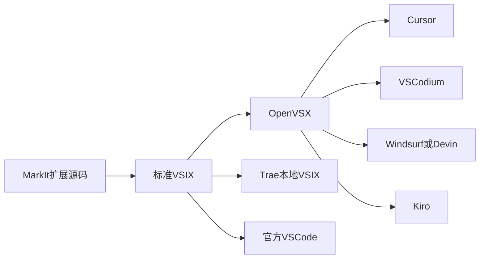

# VS Code 衍生桌面编辑器兼容性调研

> **状态：计划内容。当前仅完成调研，暂不展开实现。**
>
> 文档定位：调研 MarkIt VSCode 扩展在 Cursor、Trae 等基于 VS Code 桌面端二次开发产品中的可运行性、安装路径、兼容风险与落地方案。本报告以公开网络资料为主，结合当前 MarkIt 扩展源码和本机可验证环境形成结论。
>
> 调研日期：2026-11-10。产品排名、市场机制和扩展兼容策略变化较快，实施前应重新核对一次官方文档。

## 1. 结论摘要

1. **扩展本体具备较好的跨产品运行基础**。当前 MarkIt 扩展只使用标准 VS Code Extension API、`child_process`、`fs`、`os`、`path`，没有依赖微软专有 API；理论上可在同类桌面产品中运行。
2. **产品级兼容不能只靠“都基于 VS Code”推断**。不同产品的扩展市场、VS Code API 基线、扩展安装限制和版本策略不同，必须逐产品验证。
3. **当前 MarkIt 只对微软 VS Code Stable / Insiders 提供产品级安装支持**。检测、复制扩展目录和设置页开关均未覆盖任何第三方衍生品。
4. **推荐 Top 5 调研对象**：Cursor、VSCodium、Windsurf（现 Devin Desktop）、Trae、Kiro。该名单以公开使用率、产品覆盖和 VS Code 衍生关系综合形成，不代表厂商官方统一市场排名。
5. **最可行落地路径是标准 VSIX + Open VSX 发布**，而不是继续为每个产品硬编码扩展目录。发布后再对 Top 5 做实际安装与右键打开验证。

## 2. 范围与调研口径

### 2.1 纳入范围

- 桌面客户端，本地扩展宿主可执行 Node.js 扩展。
- 基于 VS Code / Code OSS 二次开发，或明确兼容 VS Code Extension API。
- 用户在本地资源管理器中操作本地文件。

### 2.2 排除范围

- VS Code Web、浏览器 IDE、code-server、codespaces 等 Web 形态。
- Remote SSH、WSL、Dev Containers 等远程扩展宿主场景。
- 非 VS Code 架构的 Zed、JetBrains、Visual Studio、Theia 等产品。
- Flatpak 等会阻断宿主程序启动的沙箱安装形态。

### 2.3 热度依据

公开资料中缺少各产品统一口径的月活或安装量。本报告采用两类证据：

1. **量化基线**：Stack Overflow 2025 开发者调查中“过去一年经常使用的开发环境与 AI 编码工具”数据。2026 年调查已发布，但当前公开汇总未提供同口径的逐 IDE 使用率，因此仍以 2025 年数据作为最近可横向比较的基线。
2. **补充判断**：官方产品定位、扩展生态资料、当前市场覆盖和 VS Code 衍生关系。未进入调查的新产品不与已有百分比直接横向比较。

Stack Overflow 2025 样本中与本报告相关的使用率为：

| 产品               | 使用率 |
| ------------------ | -----: |
| Cursor             |  17.9% |
| VSCodium           |   6.2% |
| Windsurf           |   4.9% |
| Trae               |   0.8% |
| Kiro               | 未单列 |
| Google Antigravity | 未单列 |

因此 Top 5 中前四款有量化依据；Kiro 作为第五款属于“新产品战略补充席位”，理由是 AWS 产品覆盖、官方明确基于 VS Code 开源基础、Open VSX 扩展机制完整。

## 3. Top 5 调研对象

| 排名口径 | 产品                     | 类型            | 纳入理由                                                         | 备注                                   |
| -------- | ------------------------ | --------------- | ---------------------------------------------------------------- | -------------------------------------- |
| 1        | Cursor                   | AI 原生 IDE     | 公开使用率最高的 VS Code 衍生 AI IDE，扩展迁移链路成熟           | 当前最优先兼容对象                     |
| 2        | VSCodium                 | Code OSS 发行版 | 公开使用率高于除 Cursor 外的 AI IDE，是重要开源桌面分支          | 非 AI 原生，但属于标准 VS Code 衍生品  |
| 3        | Windsurf / Devin Desktop | AI 原生 IDE     | 公开使用率高，产品仍在持续演进                                   | 已出现更名，需按当前安装版本验证       |
| 4        | Trae                     | AI 原生 IDE     | 国内和全球均有关注度，明确支持 VS Code Marketplace 与本地 VSIX   | 用户基数增长较快                       |
| 5        | Kiro                     | Agentic IDE     | AWS 主导，明确基于 VS Code 开源基础，Open VSX 和配置迁移边界清楚 | 调查未单列，按产品成熟度与战略价值纳入 |

### 3.1 观察名单

- **Google Antigravity**：市场关注度高，但当前官方文档同时存在独立 App、CLI、IDE 和“为 VS Code 提供扩展”多种产品形态。现有资料不足以确认其当前桌面 IDE 对 VS Code 扩展宿主和右键菜单的兼容方式，暂不纳入确认兼容范围。
- **Zed**：不是 VS Code 衍生品，排除。
- **PearAI / Void / Positron 等**：属于潜在同类产品，但当前公开热度和统一使用率证据弱于上述五款，列为后续观察项。

## 4. 逐产品调研

### 4.1 Cursor

**VS Code 关系与扩展机制**

- Cursor 官方扩展文档明确使用 Open VSX 作为第三方扩展源，并通过自身市场代理做安全审查。
- 支持从 VS Code 导入扩展、主题、设置和快捷键。
- 并非所有微软 Marketplace 独占扩展都可用；部分扩展由 Anysphere 提供替代版本。
- 官方文档当前没有明确说明“从本地 VSIX 安装”的入口，需要实际版本验证。

**对 MarkIt 的影响**

- MarkIt 使用的是标准 API，预计运行时兼容度高。
- 当前扩展未发布到 Open VSX，Cursor 用户无法通过市场搜索安装。
- 若发布到 Open VSX，Cursor 是最值得优先覆盖的渠道。

**当前判断**：高概率可运行；未发布、未实测，不能标记为已支持。

### 4.2 VSCodium

**VS Code 关系与扩展机制**

- VSCodium 是移除微软品牌、遥测和许可限制的 VS Code 二进制发行版。
- 默认使用 Open VSX，而不是微软 Marketplace。
- 部分微软专属或许可受限扩展不能使用，但标准第三方扩展通常兼容。

**对 MarkIt 的影响**

- MarkIt 不依赖微软专属 API，兼容风险较低。
- Open VSX 发布后，VSCodium 可直接搜索安装。
- 当前未发现 MarkIt 在 Open VSX 的公开条目。

**当前判断**：高概率可运行；应作为 Open VSX 发布后的首选回归对象。

### 4.3 Windsurf / Devin Desktop

**VS Code 关系与扩展机制**

- 产品长期以 VS Code 风格和 Code OSS 分支形态存在。
- 官方推荐扩展文档说明使用 Open VSX Registry，并列出 Python、Java、GitLens 等扩展。
- 产品已出现 Windsurf 到 Devin Desktop 的更名和迁移说明。
- 当前文档对扩展安装存在需要复核的口径差异：推荐页说明可通过 Open VSX 安装，入门页又提示部分市场安装限制。
- 其他 AI 补全类扩展、专有扩展可能冲突或被限制。

**对 MarkIt 的影响**

- MarkIt 是非 AI 的轻量命令扩展，冲突概率理论上低于 AI 补全类扩展。
- 产品更名和版本差异较大，必须按具体安装版本验证。
- 不建议仅按旧 Windsurf 扩展目录做硬编码检测。

**当前判断**：中高概率可运行；需在 Windows 当前版 Devin Desktop / Windsurf 上实装验证。

### 4.4 Trae

**VS Code 关系与扩展机制**

- Trae 官方扩展文档明确支持三种安装方式：
  1. Trae 扩展商店；
  2. VS Code Marketplace；
  3. 本地 `.vsix` 导入。
- 官方同时提示：扩展若依赖比 Trae 内置 VS Code 更新的 API，可能不兼容，应回退扩展版本。
- 本机 `Trae CN` 用户数据中可看到 `exthost` 日志及 `ms-python.python`、`dbaeumer.vscode-eslint` 等扩展 ID，说明其实际使用 VS Code 风格扩展宿主。
- 本机缓存目录中可看到 `.vsix` 文件，进一步验证本地 VSIX 安装链路。

**对 MarkIt 的影响**

- MarkIt 的 `engines.vscode` 要求为 `^1.85.0`，API 门槛较低，与当前 Trae 兼容概率高。
- 官方明确支持本地 VSIX，是最容易进行首轮真实测试的第三方产品。
- 当前 MarkIt 扩展没有自动安装到 Trae 的流程。

**当前判断**：高概率可运行，且是最适合先做实测的产品。

### 4.5 Kiro

**VS Code 关系与扩展机制**

- Kiro 官方迁移文档明确说明其基于 Visual Studio Code 开源基础构建。
- 支持导入 VS Code Profile，但导入内容主要覆盖主题、设置和快捷键。
- 使用 Open VSX，因此仅 Open VSX 中存在的扩展可以迁移；微软 Marketplace 独占扩展可能不可用。
- 企业环境可配置私有扩展注册表。

**对 MarkIt 的影响**

- MarkIt 的 API 使用范围小，Kiro 兼容概率高。
- 发布到 Open VSX 后可覆盖 Kiro。
- 需单独确认 Kiro 当前版本是否提供与 VS Code 完全一致的本地 VSIX 安装入口和右键菜单行为。

**当前判断**：高概率可运行；Open VSX 发布后进行实测。

## 5. MarkIt 扩展现状审计

### 5.1 兼容性有利因素

| 项目          | 当前实现                                             | 兼容影响                            |
| ------------- | ---------------------------------------------------- | ----------------------------------- |
| Extension API | `vscode.commands`、`vscode.window`                   | 标准 API，跨产品风险低              |
| 激活方式      | `onCommand:markit.openFile`                          | 通用机制                            |
| 右键菜单      | `explorer/context`                                   | 大多数 VS Code 衍生品沿用           |
| 文件筛选      | `resourceScheme == 'file'`                           | 只覆盖本地文件，符合当前范围        |
| 文件类型      | `.md` / `.markdown`                                  | 与产品特性无耦合                    |
| 本地能力      | `child_process`、`fs`、`os`、`path`                  | 桌面 Node 扩展宿主可用              |
| 启动配置      | 从 MarkIt 的 `userData/vscode-integration.json` 读取 | 与具体编辑器产品无关                |
| Electron 环境 | 启动前移除 `ELECTRON_RUN_AS_NODE`                    | 可兼容 VS Code 系扩展宿主继承的环境 |

### 5.2 当前缺口

| 缺口               | 现状                                              | 影响                                              |
| ------------------ | ------------------------------------------------- | ------------------------------------------------- |
| 未生成 VSIX        | 仅随应用复制扩展目录                              | 第三方产品安装成本高                              |
| 未发布 Open VSX    | 当前 Open VSX 搜索无 `harley-xk.markit-open` 条目 | Cursor、VSCodium、Windsurf、Kiro 无法市场搜索安装 |
| 只检测官方 VS Code | `VSCodeVariant` 只有 `stable` / `insiders`        | 第三方产品不会出现在 MarkIt 设置页                |
| 扩展目录硬编码     | 只扫描 `.vscode`、`.vscode-insiders` 等           | 不能覆盖第三方产品数据目录                        |
| 无产品实机矩阵     | 当前仅完成微软 VS Code 验证                       | 不能对外宣称支持 Top 5                            |

## 6. 兼容矩阵

| 产品                     | 扩展宿主预期 | 市场/安装方式                            | MarkIt 当前自动安装 | 当前兼容结论 |
| ------------------------ | ------------ | ---------------------------------------- | ------------------- | ------------ |
| Cursor                   | 高           | Open VSX；本地 VSIX 待实测               | 否                  | 待发布与实测 |
| VSCodium                 | 高           | Open VSX；VSIX                           | 否                  | 待发布与实测 |
| Windsurf / Devin Desktop | 中高         | Open VSX；版本策略需复核                 | 否                  | 待实机验证   |
| Trae                     | 高           | 自有商店、VS Code Marketplace、本地 VSIX | 否                  | 优先实测     |
| Kiro                     | 高           | Open VSX；本地 VSIX 需复核               | 否                  | 待实测       |

这里的“高概率可运行”只表示代码层风险评估，不等于已经正式支持。正式对外表述应区分“已验证支持”和“理论兼容”。

## 7. 推荐改造方案

### 7.1 P0：先做标准 VSIX

1. 增加 VSIX 打包脚本和构建产物。
2. 固定扩展 ID、版本、图标、发布者和最小 VS Code API 版本。
3. 在本地分别向 Trae、Cursor、VSCodium、Windsurf、Kiro 安装同一个 VSIX。
4. 保持所有产品使用同一份源码，不创建产品分叉。

### 7.2 P1：发布 Open VSX

Open VSX 是当前覆盖最广的公共渠道：

- Cursor 使用 Open VSX；
- VSCodium 默认使用 Open VSX；
- Windsurf / Devin Desktop 文档推荐 Open VSX；
- Kiro 默认使用 Open VSX；
- Trae 可同时使用 VS Code Marketplace 和本地 VSIX。

因此发布 Open VSX 的投入产出比明显高于逐产品复制目录。

### 7.3 P1：产品内说明与安装入口

建议设置页增加“其他 VS Code 兼容编辑器”说明，而不是立即做自动目录写入：

1. 展示 VSIX 下载/安装说明；
2. 提示用户先启动一次 MarkIt，生成 `vscode-integration.json`；
3. 说明远程、Web、Flatpak 不在支持范围；
4. 对已验证产品显示“已支持”，未验证产品显示“兼容性待验证”。

### 7.4 P2：按产品增加自动检测

只有在以下条件同时满足后，才建议把产品加入 MarkIt 自动检测：

1. 官方安装路径和 CLI 行为稳定；
2. Windows、macOS、Linux 至少各完成一次桌面安装验证；
3. 能可靠区分本地桌面扩展宿主与远程扩展宿主；
4. 产品升级不会静默删除或禁用扩展；
5. 失败时可定位并安全回退。

在条件不足时，优先使用 VSIX/Open VSX，不复制扩展到硬编码路径。

## 8. 验证计划

### 8.1 单产品验收项

| 验证项     | 验收标准                                                      |
| ---------- | ------------------------------------------------------------- |
| 安装       | 产品能识别并启用 `harley-xk.markit-open`                      |
| 激活       | 点击菜单后扩展宿主无报错                                      |
| 菜单可见   | 只对本地 `.md` / `.markdown` 显示                             |
| 单文件启动 | MarkIt 未运行时能启动并打开文件                               |
| 已运行实例 | MarkIt 已运行时打开新标签并聚焦                               |
| 多选       | 两个以上 Markdown 文件按顺序打开                              |
| 环境继承   | 扩展宿主带 `ELECTRON_RUN_AS_NODE=1` 时仍按桌面应用启动 MarkIt |
| 路径字符   | 中文、空格、长路径均可打开                                    |
| 重启后     | 扩展仍启用，菜单仍可用                                        |
| 升级后     | 产品升级后扩展仍可加载，必要时给出重装提示                    |

### 8.2 建议执行顺序

1. **Trae**：官方明确支持本地 VSIX，优先验证。
2. **VSCodium**：Open VSX 机制最标准，作为通用兼容基线。
3. **Cursor**：用户量最大，重点验证 Open VSX 发布和右键菜单。
4. **Kiro**：验证 Open VSX、右键菜单和 MarkIt 本地进程启动。
5. **Windsurf / Devin Desktop**：按当前版本验证市场限制和扩展冲突。

每款产品至少覆盖 Windows；进入正式支持名单前再补 macOS / Linux。

## 9. 风险与边界

1. **API 版本差异**：产品的 VS Code API 基线可能落后或超前，Trae 官方已明确提示新版 API 扩展可能不兼容。
2. **市场来源差异**：微软 Marketplace、Open VSX 和产品自有商店不是同一渠道，不能假设扩展自动互通。
3. **产品更名与目录变化**：Windsurf 已迁移到 Devin Desktop，硬编码目录容易过时。
4. **扩展策略限制**：AI 类产品可能限制其他 AI 扩展、专有扩展或企业白名单外扩展。
5. **远程宿主**：远程窗口中的扩展运行在远端，不能直接启动用户本地 MarkIt；当前不在支持范围。
6. **产品自更新**：直接复制到扩展目录的安装方式可能被产品更新或市场同步覆盖。
7. **官方文档口径冲突**：Windsurf / Devin Desktop 当前页面同时出现 Open VSX 与市场安装限制说明，必须以实机版本为准。

## 10. 最终建议

### 10.1 产品判断

- **不建议**把“兼容所有 VS Code 衍生品”作为承诺。
- **建议**把目标定义为“兼容 Top 5 桌面衍生品”，并区分已验证与理论兼容。
- **不建议**为每个产品复制独立扩展源码。
- **建议**使用统一 VSIX 和 Open VSX 发布，再针对产品差异做检测和说明。

### 10.2 优先级

| 优先级 | 动作                | 目标                                          |
| ------ | ------------------- | --------------------------------------------- |
| P0     | 生成标准 VSIX       | 提供所有产品可用的统一安装包                  |
| P0     | Trae 实机验证       | 用明确支持本地 VSIX 的产品打通首条第三方链路  |
| P1     | Open VSX 发布       | 覆盖 Cursor、VSCodium、Windsurf / Devin、Kiro |
| P1     | 建立 Top 5 兼容矩阵 | 明确已验证版本与操作系统                      |
| P2     | 按产品增加自动检测  | 在实机稳定后提升设置页体验                    |

## 11. 资料来源

网络资料均于 2026-11-10 访问：

1. [Stack Overflow 2025 Developer Survey - Technology](https://survey.stackoverflow.co/2025/technology)：开发环境与 AI 编码工具使用率。
2. [Cursor - Extensions](https://cursor.com/help/customization/extensions.md)：Open VSX、扩展兼容与市场安全策略。
3. [Cursor - Migrate from VS Code](https://cursor.com/help/getting-started/migrate-vscode.md)：扩展、设置和快捷键迁移。
4. [Trae - Manage extensions](https://docs.trae.ai/ide/manage-extensions)：Trae 扩展商店、VS Code Marketplace、本地 VSIX 和 API 版本风险。
5. [Kiro - Migrating from VSCode](https://kiro.dev/docs/upgrade-guides/migrating-from-vscode.md)：基于 VS Code 开源基础、Profile 迁移和 Open VSX 边界。
6. [Kiro - Custom extension registry](https://kiro.dev/docs/ide/editor/extension-registry.md)：默认 Open VSX 和企业私有注册表。
7. [Devin Desktop - Getting Started](https://docs.devin.ai/desktop/getting-started.md)：Windsurf 更名、VS Code / Cursor 配置迁移和扩展限制。
8. [Devin Desktop - Recommended Extensions](https://docs.devin.ai/desktop/recommended-extensions.md)：Open VSX 扩展机制。
9. [VSCodium GitHub](https://github.com/VSCodium/vscodium)：Code OSS 二进制发行版、Open VSX 与许可限制。
10. [Open VSX](https://open-vsx.org/)：开放扩展注册表。
11. [Google Antigravity - IDE Extensions](https://antigravity.google/docs/ide/extensions)：当前扩展产品形态与观察依据。
12. [Google Antigravity - Marketplace](https://antigravity.google/docs/marketplace)：当前插件市场边界。

本地验证：

- 当前仓库 MarkIt VSCode 扩展源码与 `package.json`。
- 本机 `%APPDATA%\Trae CN\logs` 中存在 `window1/exthost` 日志和 VS Code 扩展 ID。
- 本机 `%APPDATA%\Trae CN\CachedExtensionVSIXs` 中存在缓存 VSIX。
- Open VSX API 当前未检索到 `harley-xk/markit-open`。
