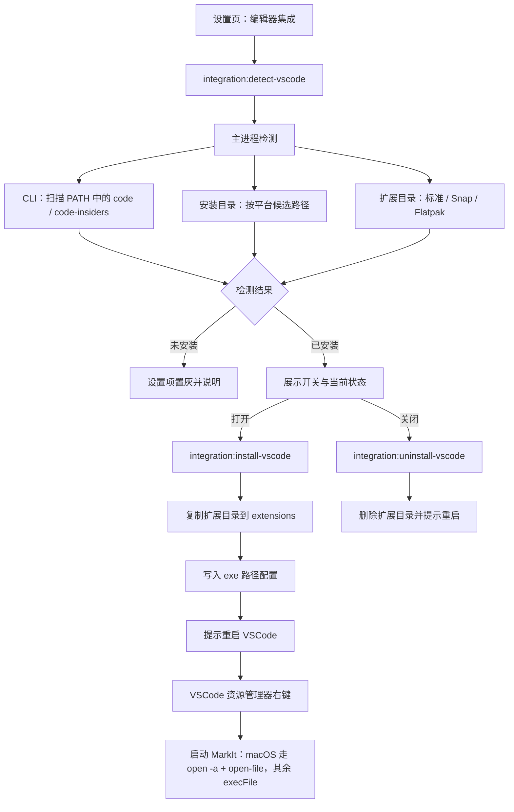
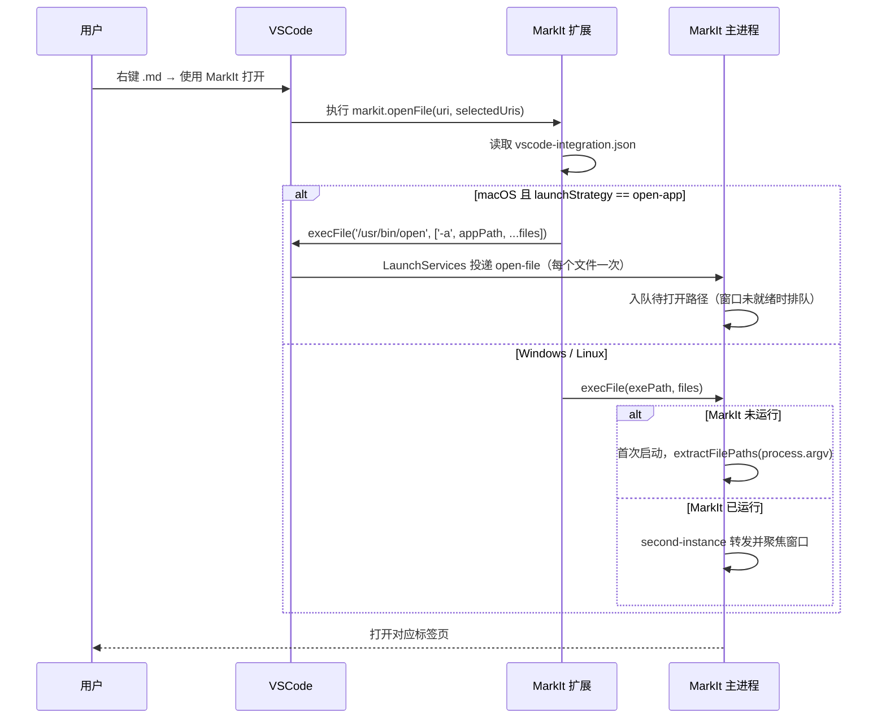

# VSCode 资源管理器集成

> 文档定位：记录「在 VSCode 资源管理器右键用 MarkIt 打开 Markdown 文件」的方案设计、三平台差异、接口契约、边界与实施计划。
> **当前状态：仅完成方案设计，代码尚未实施。** 本文按计划功能体例编写，落地前需按 [rules/base.md](../../rules/base.md) 第 4 节确认未决事项，实施时改写为正式功能文档并移回 `docs/`。
> 相关能力：系统文件关联与命令行传参见 [文件与冲突处理](../文件与冲突处理.md)。

## 1. 结论

需求可行，且可以完整做成 MarkIt 的内置功能：主进程负责检测 VSCode、安装/卸载扩展，渲染进程只负责设置项展示。不需要给渲染进程开放任何 Node 能力。

核心思路：

1. 主进程检测本机是否安装了 VSCode（稳定版 / Insiders），以及扩展目录位置；
2. 设置页展示「编辑器集成」开关，状态以文件系统为准，不持久化布尔值；
3. 打开开关时，把随应用分发的轻量扩展安装到 VSCode 扩展目录；
4. 扩展在资源管理器右键菜单提供「使用 MarkIt 打开」，点击后启动 MarkIt 并传入文件路径；
5. 关闭开关时删除扩展目录，并提示重启 VSCode。

能力边界：

| 做                                                    | 不做                                                   |
| ----------------------------------------------------- | ------------------------------------------------------ |
| Windows、macOS、Linux 三平台同为首期范围              | 替代 VSCode 内置 Markdown 预览作为默认编辑器           |
| 资源管理器右键菜单打开 `.md` / `.markdown`            | 支持 VSCode 便携版、Remote / WSL / Dev Containers 路径 |
| 支持多选、支持打开到已运行的 MarkIt 实例              | 在 Flatpak 沙箱版 VS Code 内启动宿主程序（首期禁用）   |
| 检测稳定版与 Insiders，分别安装                       | 写入 VSCode 内部配置或修改用户 `settings.json`         |
| 按发行方式定位扩展目录，识别标准安装 / Snap / Flatpak | 卸载 MarkIt 时自动清理扩展（首期不做，见第 10 节）     |
| 卸载时清理扩展目录                                    |                                                        |

## 2. 需求与约束

1. **触发方式**：VSCode 资源管理器右键 →「使用 MarkIt 打开」。不要求把 MarkIt 设为 VSCode 的默认编辑器（VSCode 也没有该机制，外部程序只能通过扩展命令触发）。
2. **零手工步骤**：用户在 MarkIt 设置中打开开关即可完成安装，不需要自己解压扩展、配置 PATH 或执行命令行。
3. **状态可信**：设置页显示的「已安装」必须与磁盘实际状态一致，用户在 VSCode 里手动卸载后，MarkIt 能识别到。
4. **可卸载**：关闭开关移除扩展；不影响 VSCode 其它扩展与用户配置。
5. **安全**：不引入任意命令执行能力，不经过 shell，不接受渲染进程传入的可执行文件路径。
6. **跨平台**：Windows、macOS、Linux 同为首期范围。三者共用「检测 → 安装扩展 → 扩展启动 MarkIt」的主链路，差异集中在三处：候选路径、扩展目录（Linux 需区分 deb / Snap 版 VS Code）、启动策略（macOS 走 LaunchServices）。VSCode 便携版与 Flatpak 沙箱版不在支持范围，见第 4.3 节。

## 3. 方案总览



## 4. 检测

### 4.1 检测顺序

稳定版（`stable`）与 Insiders（`insiders`）分别检测，互不影响。CLI 统一由主进程扫描 `process.env.PATH`（按 `path.delimiter` 拆分，Windows 再按 `PATHEXT` 补全扩展名），不调用 `where` / `which`，避免 shell 与平台差异，也便于单测。

**Windows（`win32`）**

1. PATH 中的 `code.cmd` / `code.exe`；
2. `%LOCALAPPDATA%\Programs\Microsoft VS Code\bin\code.cmd`；
3. `%ProgramFiles%\Microsoft VS Code\bin\code.cmd`、`%ProgramFiles(x86)%\Microsoft VS Code\bin\code.cmd`；
4. 扩展目录：`%USERPROFILE%\.vscode\extensions`。

**macOS（`darwin`）**

1. PATH 中的 `code`（用户执行过 _Install 'code' command in PATH_ 时才存在）；
2. `/Applications/Visual Studio Code.app/Contents/Resources/app/bin/code`；
3. `~/Applications/Visual Studio Code.app/Contents/Resources/app/bin/code`；
4. 扩展目录：`~/.vscode/extensions`。

**Linux（`linux`）**

1. PATH 中的 `code` / `code-insiders`；
2. `/usr/share/code/bin/code`（deb / rpm）、`/snap/bin/code`；
3. 扩展目录按发行方式探测，取第一个存在的：

| 发行方式            | 扩展目录                                                  |
| ------------------- | --------------------------------------------------------- |
| deb / rpm / tarball | `~/.vscode/extensions`                                    |
| Snap                | `~/snap/code/current/.vscode/extensions`                  |
| Flatpak             | `~/.var/app/com.visualstudio.code/data/vscode/extensions` |

同时探测到多个目录时，优先取与第 1、2 步命中的 CLI 属于同一发行方式的目录；无法判断时按「标准 → Snap → Flatpak」顺序取第一个（Flatpak 放最后，避免在标准安装可用时误判为不支持），并在设置页展示实际使用的目录，便于排查。

Insiders 把上述规则中的 `code` 替换为 `code-insiders`、`.vscode` 替换为 `.vscode-insiders`、应用名替换为 `Microsoft VS Code Insiders` / `Visual Studio Code - Insiders.app`；Snap / Flatpak 的包名与数据目录同理替换，实施时以本机实测路径为准。

只要扩展目录存在就视为「可安装」，CLI 是否存在只影响第 6.2 节的增强安装方式，不阻塞主方案。例外是 Flatpak：扩展运行在沙箱内，默认无法执行宿主的 MarkIt 可执行文件，检测到 Flatpak 版时标记为不支持（见第 4.3 节）。

### 4.2 数据结构

```ts
type VSCodeVariant = 'stable' | 'insiders'
type VSCodeInstallKind = 'standard' | 'snap' | 'flatpak'

interface VSCodeInstallation {
  variant: VSCodeVariant
  installKind: VSCodeInstallKind
  cliPath: string | null
  extensionsDir: string
  installed: boolean
  installedVersion: string | null
  needsRestart: boolean
  unsupportedReason: string | null
}
```

`installKind` 为 `standard` 时对应 Windows / macOS 标准安装与 Linux deb / rpm / tarball；Linux Snap 与 Flatpak 分别取 `snap` / `flatpak`。`unsupportedReason` 在 Flatpak 与 macOS translocation 两种情况下非空，此时 `installed` 恒为 `false`。

`installed` 的判定：扫描 `extensionsDir` 下是否存在符合 `harley-xk.markit-open-<version>` 命名的目录；`installedVersion` 取目录名中的版本，缺失时回退读取扩展内 `package.json`。

### 4.3 边界

| 场景                                       | 行为                                                                                            |
| ------------------------------------------ | ----------------------------------------------------------------------------------------------- |
| VSCode 未安装                              | 设置项置灰，文案说明「未检测到 VSCode」                                                         |
| 仅安装 Insiders                            | 只展示 Insiders 一项                                                                            |
| 稳定版与 Insiders 同时存在                 | 各展示一项，可分别开关                                                                          |
| Linux 同时安装 deb 与 Snap                 | 按 4.1 优先级取一个，设置页展示实际使用的扩展目录                                               |
| Flatpak 版 VSCode                          | 标记不支持，开关禁用并说明沙箱限制                                                              |
| 便携版（portable）                         | 不识别；扩展目录不在常规位置                                                                    |
| VSCode Remote / WSL / SSH / Dev Containers | 扩展菜单通过 `resourceScheme == 'file'` 隐藏，避免本机打不开远端路径                            |
| macOS 从 DMG 直接运行（translocation）     | 检测到路径位于 `/private/var/folders/**/AppTranslocation/**` 时提示移入「应用程序」，不写入配置 |
| 扩展目录存在但 `code` 不在 PATH            | 仍可安装（目录复制方案），只是无法自动打开 VSCode 提示                                          |
| AppImage 移动位置后未重启 MarkIt           | 配置仍指向旧路径，菜单点击失败并提示；重启 MarkIt 后自动修复                                    |
| 开发模式（`app.isPackaged === false`）     | 设置项禁用并提示用打包产物验证，避免把开发用的 `electron.exe` 写入扩展配置                      |

## 5. VSCode 扩展

### 5.1 目录与清单

扩展源码随应用分发，放在 `resources/vscode-extension/`。[electron-builder.yml](../../electron-builder.yml) 已配置 `asarUnpack: resources/**`，因此主进程可以直接从磁盘读取并复制。

```text
resources/vscode-extension/
├── package.json      # 扩展清单：贡献命令、菜单、when 条件
├── extension.js      # 激活逻辑：启动 MarkIt 并传入文件路径
└── markit-path.json  # 安装时写入的 exe 路径兜底快照（构建产物中不存在）
```

`package.json` 关键字段：

```json
{
  "name": "markit-open",
  "displayName": "打开 MarkIt",
  "description": "在资源管理器右键使用 MarkIt 打开 Markdown 文件",
  "publisher": "harley-xk",
  "version": "1.0.0",
  "engines": { "vscode": "^1.85.0" },
  "main": "./extension.js",
  "activationEvents": ["onCommand:markit.openFile"],
  "contributes": {
    "commands": [{ "command": "markit.openFile", "title": "使用 MarkIt 打开" }],
    "menus": {
      "explorer/context": [
        {
          "command": "markit.openFile",
          "when": "resourceScheme == 'file' && resourceExtname =~ /^\\.(md|markdown)$/",
          "group": "navigation"
        }
      ]
    }
  }
}
```

扩展 ID 固定为 `harley-xk.markit-open`，安装目录命名 `harley-xk.markit-open-<version>`。

### 5.2 命令实现

`explorer/context` 的命令会收到 `(uri, selectedUris)`。多选时把 `selectedUris` 全部传给 MarkIt；MarkIt 的 argv 链路已支持一次打开多个文件（见 [文件与冲突处理](../文件与冲突处理.md) 第 2 节）。

```js
const vscode = require('vscode')
const { execFile } = require('node:child_process')

function showLaunchError(error) {
  if (error) {
    vscode.window.showErrorMessage(`启动 MarkIt 失败：${error.message}`)
  }
}

function activate(context) {
  context.subscriptions.push(
    vscode.commands.registerCommand('markit.openFile', (uri, selectedUris) => {
      const targets = (selectedUris?.length ? selectedUris : [uri])
        .filter((item) => item && item.fsPath)
        .map((item) => item.fsPath)

      if (targets.length === 0) return

      const config = loadMarkItConfig(context.extensionPath)
      if (config.launchStrategy === 'open-app' && config.appPath) {
        // macOS：交给 LaunchServices，已运行实例同样会收到 open-file
        execFile('/usr/bin/open', ['-a', config.appPath, ...targets], (error) => {
          if (!error) return
          execFile(config.exePath, targets, showLaunchError)
        })
      } else {
        execFile(config.exePath, targets, showLaunchError)
      }
    })
  )
}
```

### 5.3 定位 MarkIt 可执行文件

扩展不能硬编码安装路径。采用两级配置：

1. **主配置**：MarkIt 每次启动时把配置写入 `app.getPath('userData')/vscode-integration.json`，扩展命令执行时读取，应用移动安装位置后自动生效；
2. **兜底**：安装扩展时把同一份内容写入扩展目录内的 `markit-path.json`，主配置缺失时使用。

扩展进程不能调用 Electron，需自行按平台推导主配置路径：

| 平台    | 路径                                                                           |
| ------- | ------------------------------------------------------------------------------ |
| Windows | `%APPDATA%\mark-it\vscode-integration.json`                                    |
| macOS   | `~/Library/Application Support/mark-it/vscode-integration.json`                |
| Linux   | `$XDG_CONFIG_HOME/mark-it/vscode-integration.json`（默认 `~/.config/mark-it`） |

路径中的目录名与 [开发指南](../开发指南.md) 第 8.4 节的 `userData` 约定一致（`mark-it`，不是 `Mark It`）。开发模式下主配置写入 `mark-it-dev`，扩展仍读正式目录，此时依赖 `markit-path.json` 兜底快照；该功能的验收以打包产物为准。

**可执行文件路径（`exePath`）按平台取值：**

| 平台    | `exePath`                                    | 说明                                                                                                          |
| ------- | -------------------------------------------- | ------------------------------------------------------------------------------------------------------------- |
| Windows | `app.getPath('exe')`                         | NSIS 安装目录下的 `Mark It.exe`                                                                               |
| macOS   | `process.execPath`                           | `.app` 内的 `Contents/MacOS/Mark It`，仅作 `open -a` 失败后的兜底                                             |
| Linux   | `process.env.APPIMAGE ?? app.getPath('exe')` | AppImage 下 `execPath` 指向 `/tmp/.mount_*` 临时挂载点，退出即失效，必须优先用 `APPIMAGE`；deb 安装取安装目录 |

**启动策略按平台取值：**

| 平台            | `launchStrategy` | 实现                                                                                                          |
| --------------- | ---------------- | ------------------------------------------------------------------------------------------------------------- |
| Windows / Linux | `exec`           | `execFile(exePath, files)`；已运行实例经 `second-instance` 转发并聚焦                                         |
| macOS           | `open-app`       | `execFile('/usr/bin/open', ['-a', appPath, ...files])`，由 LaunchServices 投递 `open-file`；失败时回退 `exec` |

macOS 选择 `open -a` 的理由：避免直接执行 `.app` 内二进制绕过 LaunchServices 导致的激活 / 聚焦问题；应用位于只读 DMG 挂载点时 `open` 仍可用；同时补齐 Finder 双击 `.md` 的链路——当前主进程没有 `open-file` 监听，本次一并加上。回退的 `exec` 路径会绕过 LaunchServices 单实例机制，依赖 `requestSingleInstanceLock` 兜底，需在 11.2 实测。

配置结构：

```ts
interface VSCodeIntegrationConfig {
  version: 1
  platform: 'win32' | 'darwin' | 'linux'
  launchStrategy: 'exec' | 'open-app'
  exePath: string
  appPath?: string
  updatedAt: string
}
```

`appPath` 仅 macOS 写入，由 `process.execPath` 逐级取父目录得到（`Contents/MacOS/<exe>` 上溯三层即 `.app`）。主进程新增 `open-file` 监听，必须在 `app.whenReady()` 之前注册：窗口未就绪时把路径入队，就绪后复用现有 `openFilesAtPaths` 链路，与 `second-instance` 共用同一队列。

不使用 `markit://` 自定义协议。协议方案虽然能彻底解耦路径，但会新增一条系统级协议注册与 URL 解析链路，收益不足以覆盖本期成本，列入后续可选项。

### 5.4 第一次点击的时序



## 6. 安装与卸载

### 6.1 主方案：复制扩展目录

主进程直接操作文件系统，不依赖 VSCode CLI：

1. 读取 `resources/vscode-extension/`；
2. 复制到 `<extensionsDir>/harley-xk.markit-open-<version>/`（`extensionsDir` 取 4.1 的检测结果）；
3. 写入 `markit-path.json`（按 5.3 的平台字段生成）与 `install.json`（记录安装时间、MarkIt 版本）；
4. 删除同扩展 ID 的其它旧版本目录；
5. 返回 `needsRestart: true`，由设置页提示「重启 VSCode 后生效」。

三平台共用同一套目录复制逻辑：Windows / macOS 标准安装、Linux deb / Snap 的扩展目录都在用户主目录下，权限要求一致；Flatpak 变体在检测阶段即标记不支持，不进入本流程。

选择理由：VSCode 启动时会扫描扩展目录，手动放入合法扩展目录是可用且常见的方式；不引入 `@vscode/vsce` 构建依赖，也不需要用户把 `code` 加入 PATH，离线可用。

### 6.2 增强：CLI 安装（待定）

检测到 `code` CLI 时，可改为 `code --install-extension <vsix> --force`。该方式由 VSCode 自己维护安装元数据与升级提示，体验更好，但需要构建期生成 vsix 并随包分发。本期不做，列入第 10 节未决事项。

### 6.3 版本与升级

- 扩展版本跟随应用版本：安装时写入 `install.json`，记录 `appVersion` 与 `extensionVersion`；
- 应用启动或打开设置页时比较 `install.json.appVersion` 与当前版本，不一致则在设置页提示「扩展需更新」，点击后重装；
- 不自动静默重装，避免在用户无感知时改动 VSCode 扩展目录。

### 6.4 卸载

关闭开关时删除 `harley-xk.markit-open-*` 目录，并提示重启 VSCode。用户在 VSCode 扩展面板手动卸载时，目录会消失，设置页下次检测即为「未安装」，无需额外同步。

MarkIt 卸载时不自动清理扩展，列为后续项。Windows 需要 NSIS 自定义卸载宏；macOS / Linux 没有统一卸载器（DMG 拖出、AppImage 删文件、deb 由包管理器移除），需要各自的清理脚本，因此一并放到后续项。此时扩展仍存在但配置缺失，点击菜单会提示「启动 MarkIt 失败」，不会静默失败。

## 7. IPC 契约

新增通道，按 [IPC接口与进程契约](../IPC接口与进程契约.md) 的要求三处同步（主进程 `ipcMain.handle`、preload `ipcRenderer.invoke`、`src/preload/index.d.ts`）。

| 通道                           | 方向   | 参数          | 返回                   | 说明                   |
| ------------------------------ | ------ | ------------- | ---------------------- | ---------------------- |
| `integration:detect-vscode`    | invoke | 无            | `VSCodeInstallation[]` | 检测安装状态与扩展状态 |
| `integration:install-vscode`   | invoke | `{ variant }` | `IntegrationResult`    | 复制扩展目录并写入配置 |
| `integration:uninstall-vscode` | invoke | `{ variant }` | `IntegrationResult`    | 删除扩展目录           |

```ts
interface IntegrationResult {
  ok: boolean
  error?: string
  needsRestart: boolean
}
```

共享类型新增 `src/shared/integration-types.ts`（仅类型，禁止运行时依赖）。主进程实现放在 `src/main/vscode-integration.ts`，检测中的路径推断抽成可单测的纯函数（入参为平台、环境变量与文件探测结果，不直接读全局状态）。

平台分支只发生在主进程：渲染层拿到的是 `installKind` / `unsupportedReason` 等字段，不自行判断 `process.platform`。macOS 的 `open-file` 监听同样放在主进程，与 IPC 无关。

参数校验：`variant` 只接受 `'stable' | 'insiders'`；所有路径由主进程自行推断，渲染进程不能传入目录或可执行文件路径。

## 8. 设置界面

设置弹窗新增「编辑器集成」区块，建议拆成独立组件 `components/settings/VSCodeIntegration.vue`，避免 [SettingsDialog.vue](../../src/renderer/src/components/settings/SettingsDialog.vue) 继续膨胀。

| 状态             | 展示                                                                                 |
| ---------------- | ------------------------------------------------------------------------------------ |
| 未检测到         | 灰态说明「未检测到 VSCode」，不展示开关                                              |
| 不支持           | 灰态展示 `unsupportedReason`（Flatpak 沙箱限制、MarkIt 位于只读 DMG 等），不展示开关 |
| 已检测、未安装   | 开关关闭，副文案说明作用与「需重启 VSCode」                                          |
| 已安装           | 开关打开，显示扩展版本；版本落后时追加「需更新」提示                                 |
| 多个发行方式并存 | 副文案展示实际使用的扩展目录，便于排查                                               |
| 开发模式         | 灰态禁用，提示用打包产物验证                                                         |
| 操作失败         | 保持原状态，展示错误原因（目录不可写、权限不足等）                                   |

状态不写入 `localStorage`，每次打开设置页重新调用 `integration:detect-vscode`。

## 9. 安全与不变量

1. 不使用 `shell: true`，全部通过 `execFile` 传参数数组，路径中的空格与引号不会被解释；
2. 只操作 `extensionsDir` 下固定命名（`harley-xk.markit-open-*`）的目录，删除前校验目录名，防止误删用户其它扩展；
3. 扩展只执行主进程写入配置中的可执行文件，macOS 额外允许固定的 `/usr/bin/open`；不读取环境变量中的命令；
4. 不新增网络请求，不上传任何信息；
5. 不改变现有 `fileAssociations`、`markit-file://`、`markit-*` 存储键与更新链路；
6. macOS 的 `open` 只接受主进程写入的 `.app` 路径与用户选中的文件路径，不接受扩展侧传来的可执行文件或任意参数；
7. Linux 启动只指向 MarkIt 自身可执行文件（`APPIMAGE` 需校验存在且可执行，否则回退安装目录），不经过 Snap / Flatpak 的间接执行；
8. 渲染进程仍然不能 `import 'electron'`，全部能力经 preload 白名单暴露。

## 10. 未决事项

| 事项                         | 选项                                       | 建议                                     |
| ---------------------------- | ------------------------------------------ | ---------------------------------------- |
| 安装方式                     | 目录复制 / vsix + CLI                      | 首期目录复制；CLI 作为后续增强           |
| 扩展版本策略                 | 跟随应用版本 / 独立版本                    | 跟随应用版本，写入 `install.json`        |
| 卸载 MarkIt 时清理           | 不处理 / Windows NSIS + macOS / Linux 脚本 | 后续补齐，首期不做                       |
| 协议解耦                     | 配置路径 / 注册 `markit://` 协议           | 首期配置路径；协议方案列入长期可选项     |
| 便携版 VSCode                | 不支持 / 扫描便携数据目录                  | 首期不支持，按需求再评估                 |
| Flatpak 版 VSCode            | 禁用 / `flatpak-spawn --host`              | 首期禁用，后续按需求评估沙箱放行方式     |
| macOS 启动策略               | `open -a` + `open-file` / 直接 exec        | 已定 `open -a`，实施时实测聚焦与多选时序 |
| Linux 多发行方式并存         | 只装优先级最高的目录 / 全部安装            | 首期单目录（按 4.1 优先级），后续可扩展  |
| 菜单是否也加到编辑器标签右键 | 仅资源管理器 / 资源管理器 + 编辑器标签     | 首期仅资源管理器，避免菜单冗余           |

## 11. 测试计划

### 11.1 单元测试

检测逻辑中的路径推断抽成纯函数（入参为平台、环境变量、PATH 条目与文件系统探测结果，输出 `VSCodeInstallation[]`），在 `src/main/vscode-integration.spec.ts` 覆盖：

- 只有稳定版、只有 Insiders、两者都有、都没有；
- CLI 存在与不存在两种组合；
- 扩展目录内存在多个旧版本目录时只识别最高版本；
- 扩展目录不存在时 `installed` 恒为 `false`；
- 三个平台分别返回对应的候选路径（Windows Program Files、macOS app bundle、Linux deb / Snap）；
- Linux 同时存在 Snap / Flatpak / 标准目录时按优先级选取，并返回正确的 `installKind`；
- Flatpak 变体返回 `unsupportedReason` 且 `installed` 恒为 `false`；
- `APPIMAGE` 环境变量存在时取 AppImage 路径，缺失时回退安装目录；
- macOS translocation 路径（`/private/var/folders/**/AppTranslocation/**`）被判定为不可用。

不 mock 被测对象内部实现；`fs` 与 `child_process` 属于边界，可以 mock。

### 11.2 手工验证

实施时在 [测试与质量保障](../测试与质量保障.md) 手工验证矩阵中分配编号，至少覆盖：

| 平台              | 场景                        | 预期                                           |
| ----------------- | --------------------------- | ---------------------------------------------- |
| 通用              | 安装后重启 VSCode           | 资源管理器右键出现「使用 MarkIt 打开」         |
| 通用              | 点击菜单、MarkIt 未运行     | 启动并打开文件                                 |
| 通用              | 点击菜单、MarkIt 已运行     | 已有实例打开新标签并聚焦窗口                   |
| 通用              | 多选多个 md 文件            | 全部打开                                       |
| 通用              | 非 md 文件右键              | 不出现菜单项                                   |
| 通用              | VSCode 远程 / WSL 工作区    | 不出现菜单项                                   |
| 通用              | 在 VSCode 扩展面板手动卸载  | MarkIt 设置页恢复为「未安装」                  |
| 通用              | 关闭开关                    | 扩展目录被删除，重启后菜单消失                 |
| Windows           | MarkIt 移动安装目录后点击   | 仍能启动（主配置已更新）                       |
| macOS             | 安装后重启 VSCode           | 资源管理器右键出现菜单项                       |
| macOS             | Finder 双击 `.md`           | MarkIt 打开文件（验证新增的 `open-file` 链路） |
| macOS             | MarkIt 已运行时点击菜单     | 已有实例接收 `open-file` 并聚焦窗口            |
| macOS             | 从 DMG 直接运行 MarkIt      | 设置页提示移入「应用程序」，不写入配置         |
| Linux（deb）      | 安装后重启 VSCode           | 资源管理器右键出现菜单项                       |
| Linux（Snap）     | 安装后重启 VSCode           | 扩展写入 `~/snap/...` 目录并生效               |
| Linux（Flatpak）  | 打开设置页                  | 显示「暂不支持」且开关禁用                     |
| Linux（AppImage） | 移动 AppImage 后重启 MarkIt | 菜单仍能启动（`APPIMAGE` 已刷新）              |

e2e 不适合覆盖（依赖本机 VSCode 安装），不加入 Playwright 用例。

## 12. 实施步骤

1. 确认第 10 节未决事项，将本文改写为正式功能文档并移回 `docs/`；
2. 新增 `src/shared/integration-types.ts`，同步 IPC 契约文档；
3. 新增 `src/main/vscode-integration.ts`：平台路径推断纯函数（PATH 扫描、扩展目录优先级、Flatpak 识别）、`APPIMAGE` / `exePath` 解析、复制安装、卸载、配置写入；
4. 主进程新增 `open-file` 监听（`app.whenReady()` 之前注册），接入现有待打开队列；
5. 主进程 IPC 注册 + preload 暴露 + `index.d.ts` 类型声明（三处同步）；
6. 新增 `resources/vscode-extension/` 扩展源码，按 `launchStrategy` 分支启动；
7. 新增设置页组件与状态展示，更新 [welcome.md](../../src/renderer/src/assets/welcome.md)；
8. 补 `vscode-integration.spec.ts`（含三平台路径推断），执行 `npm run lint`、`npm run typecheck`、`npm test`；
9. Windows 用 `npm run build:unpack` 的 `dist/win-unpacked/Mark It.exe` 走完第 11.2 节；macOS / Linux 分别在对应产物上验证同一矩阵，Flatpak 版 VSCode 仅验证禁用状态。
