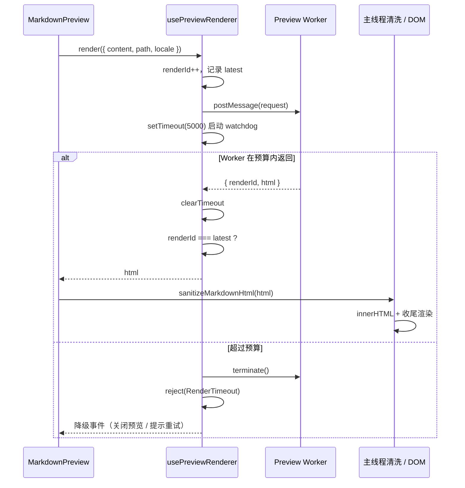
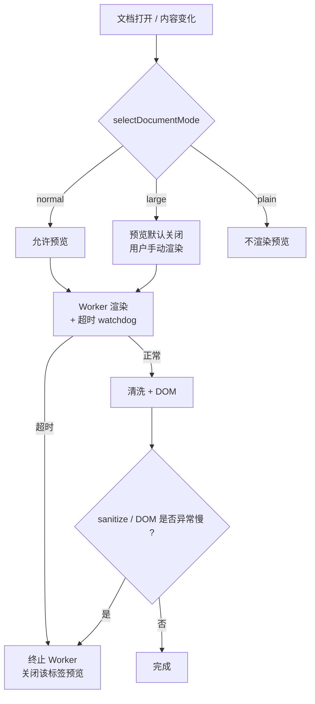

# 预览渲染 Worker 超时终止方案

> **状态：规划中，未开工（2026-11-16）。** 本文只定义方案，不代表代码已实现；当前预览仍在渲染进程主线程同步渲染。
> 文档定位：解决「同步 Markdown 渲染无法被超时中断」的问题，给出 Worker 化、watchdog、终止、降级与安全边界的完整设计。
> 前置依赖：[预览渲染后续优化计划](./预览渲染后续优化计划.md) 的方案 A（增量渲染）与方案 B（Worker 渲染）、[大文件能力降级方案](../编辑与预览/大文件能力降级方案.md)。
> 最后核对：2026-11-16。

## 1. 背景与问题

### 1.1 当前渲染管线

[MarkdownPreview.vue](../../src/renderer/src/components/preview/MarkdownPreview.vue) 的核心路径全部在渲染进程主线程同步执行：

```ts
const { entries, body } = parseFrontmatter(doc.content)
const frontmatter = entries.length > 0 ? renderFrontmatterTable(entries, locale.value) : ''
const html = sanitizeMarkdownHtml(frontmatter + md.render(body))
layer.content.innerHTML = html
```

`scheduleDocumentRender` 的 150ms 防抖只能合并连续输入，不能中断已经开始的一次渲染。

### 1.2 为什么不能用定时器超时

| 环节                                            | 执行位置         | 能否被主线程定时器中断               |
| ----------------------------------------------- | ---------------- | ------------------------------------ |
| `parseFrontmatter` / `md.render` / highlight.js | 主线程，同步     | 否                                   |
| `sanitizeMarkdownHtml`（DOMPurify）             | 主线程，同步     | 否                                   |
| `innerHTML` 赋值 + 样式重算 + 布局              | 主线程，同步     | 否                                   |
| Mermaid 图表渲染                                | 主线程，异步分批 | 可取消（现有 generation / 缓存机制） |

JavaScript 单线程：同步调用栈未清空时，`setTimeout` 回调不会执行。因此「渲染超过 5 秒就终止」在同步管线上无法实现，markdown-it 也没有取消 API。

### 1.3 与阈值方案的分工

[大文件能力降级方案](../编辑与预览/大文件能力降级方案.md) 用确定性阈值阻止「已知的大文档」进入预览，避免第一次打开就卡死。但阈值无法覆盖所有病态输入：

- 体积不大但嵌套极深、表格极宽、引用定义或插件展开异常的文档；
- 体积在阈值内，但机器性能明显低于基准机；
- 未来新增插件或渲染规则导致成本突增。

Worker 超时终止是**最后一道保险**：允许渲染的文档仍然可能耗时失控，此时必须能硬性终止并让界面恢复可用。

## 2. 目标与非目标

**目标**

1. 把 Markdown 解析与高亮移出主线程，主线程在渲染期间保持可响应。
2. 渲染超过预算时可硬性终止，界面不冻结，用户能看到降级提示。
3. 过期渲染结果不得覆盖新内容；快速连续输入只保留最新一次。
4. Worker 不可用或崩溃时有明确降级路径，不把应用卡死。
5. 安全边界不后退：Worker 产物仍必须经过现有清洗后才能进入 DOM。

**非目标**

- 不把 DOMPurify、`innerHTML`、布局与 Mermaid 搬进 Worker（见第 3 节）；
- 不替代增量渲染（方案 A）；本方案可与方案 A 组合；
- 不改变 Markdown 渲染语义与导出管线；
- 不引入外部渲染服务或独立进程。

## 3. 方案边界：超时只能覆盖一部分管线

| 阶段                       | 迁移到 Worker | 超时覆盖 | 说明                             |
| -------------------------- | ------------- | -------- | -------------------------------- |
| frontmatter 解析与表格生成 | 是            | 是       | 纯字符串处理                     |
| markdown-it `render`       | 是            | 是       | 本方案的主要目标                 |
| highlight.js 代码高亮      | 是            | 是       | 随 markdown-it 插件执行          |
| 本地图片 URL 改写          | 是            | 是       | 只依赖文档路径，不依赖 DOM       |
| DOMPurify 清洗             | 否            | 否       | 依赖 DOM，留在主线程             |
| `innerHTML` + 布局         | 否            | 否       | 只能主线程执行                   |
| Mermaid 渲染               | 否            | 否       | 依赖 DOM / SVG，现有异步分批机制 |

**关键结论**：Worker 超时保护的是「源码 → HTML 字符串」这一段，不能覆盖清洗与 DOM 插入。因此：

1. 阈值方案仍然是第一道防线；
2. 本方案必须记录清洗与 DOM 阶段的耗时，避免出现「Worker 很快，但主线程清洗 7 MB HTML 仍然卡住」的盲区；
3. 若后续要连清洗一起保护，只有两条路：
   - 在 Worker 内使用 DOM 实现（如 jsdom）：体积、内存与安全面都明显变大，**不推荐**；
   - 换成无 DOM 的 HTML 清洗库（如 `sanitize-html`）：属于安全关键实现替换，必须单独评审并补齐全部清洗回归，**不作为本方案首版内容**。

## 4. 架构

### 4.1 请求与响应

```ts
interface PreviewRenderRequest {
  /** 单调递增；主线程只接受最新值 */
  renderId: number
  content: string
  /** 本地图片相对路径的解析基准 */
  path: string | null
  locale: Locale
  /** 预留：主题不影响 HTML，但图表 / 插件扩展可能需要 */
  options?: Record<string, never>
}

interface PreviewRenderResponse {
  renderId: number
  /** 未清洗的 HTML；主线程必须再走 sanitizeMarkdownHtml */
  html: string
}
```

### 4.2 时序



### 4.3 Worker 生命周期

- **作用域**：每个编辑窗口一个 Worker，懒创建；设置窗口与更新窗口不加载。
- **构建**：使用 Vite `?worker` 导入，复用 [utils/markdown.ts](../../src/renderer/src/utils/markdown.ts) 的 `createMarkdownRenderer`，避免主线程与 Worker 渲染规则分叉。
- **销毁**：预览组件卸载、窗口关闭时 `terminate()`；连续超时后不保留可疑实例。
- **重建**：超时终止或 `error` 事件后，下一次请求重新创建；重建失败按 5.2 降级。
- **内存**：Worker 内的 markdown-it 实例与高亮缓存随 Worker 终止释放，不需要额外 LRU。

### 4.4 并发与结果一致性

- 同一时刻只允许一个在途渲染；输入继续变化时只保留**最新内容**，中间版本直接丢弃。
- 在途渲染不能单独取消：通常等在途请求完成后再发最新内容；若用户切走标签或明确要求立即刷新，可终止 Worker 后重建，代价是丢掉当前计算。
- 收到结果时校验 `renderId`：不等于最新值则丢弃，不发往 DOM。
- 超时终止后，在途请求统一 reject；新的请求使用新的 `renderId` 与新的 Worker。
- 与现有 `htmlCache` 的关系：缓存仍留在主线程，键继续使用「文档 id + content + path + locale」；Worker 只负责未命中时的计算。

## 5. 超时、降级与恢复

### 5.1 超时预算

| 常量                       | 初值 | 说明                                 |
| -------------------------- | ---- | ------------------------------------ |
| `WORKER_RENDER_TIMEOUT_MS` | 5000 | 暂定；阈值方案生效后只应作为异常保险 |

- 5 秒是用户可感知的明显等待，校准后应尽量下调；
- 超时从 `postMessage` 开始计时，覆盖 Worker 启动与排队；
- 不在 Worker 内做进度上报：Markdown 渲染没有可靠的进度粒度，伪进度会误导用户。

### 5.2 降级阶梯

| 事件                          | 处理                                               | 用户可见结果                                                  |
| ----------------------------- | -------------------------------------------------- | ------------------------------------------------------------- |
| 正常返回                      | 清洗 → 更新 DOM                                    | 与现状一致                                                    |
| 超时                          | 终止 Worker、丢弃请求、标记该标签 `renderDegraded` | 预览关闭，显示「渲染超时，已暂停预览」与「重试」              |
| 超时后用户点「重试」          | 重建 Worker，再给一次超时预算                      | 再失败则保持关闭，并提示可用编辑器继续工作                    |
| Worker `error` / 崩溃         | reject 在途请求、重建 Worker                       | 下一次渲染正常尝试；连续失败则降级                            |
| Worker 构造失败（环境不支持） | 不自动回主线程渲染大文档                           | `normal` 文档可回退主线程一次；`large` / `plain` 保持预览关闭 |

**不做自动主线程回退。** 超时通常意味着主线程渲染同样会卡死；自动回退等于把用户再冻结一次。只有用户显式点击「在主线程重试（可能卡顿）」时才允许回退。

### 5.3 降级状态的归属

- `renderDegraded` 按标签保存在渲染进程内存中，不写入会话；
- 切换标签或重新打开文件后重新判定；
- 标记只影响预览，不改变编辑、保存与文件权限。

## 6. Worker 内可用能力与限制

**允许**

- `parseFrontmatter`、`renderFrontmatterTable`（按传入 `locale`）；
- `createMarkdownRenderer`、highlight.js 与全部纯字符串插件；
- `installLocalImageRule`（依赖文档路径，不依赖 DOM）；
- `installHeadingAnchors`、`installLinkTitles` 等纯 token 规则。

**禁止**

- 任何 `document` / `window` / `HTMLElement` / DOMPurify；
- Electron / Node API；
- Mermaid 渲染、图片加载、表格列宽测量。

**跨线程数据**

- 请求发送 `content` 字符串；大文档的结构化克隆成本需实测，必要时改为 `ArrayBuffer` + `TextDecoder` 传输，但首版不做提前优化；
- 响应只返回 HTML 字符串；HTML 可能达到源文档的 1.4 倍（5 MiB 语料实测约 7.3 MB），克隆成本计入监控。

## 7. 安全边界

1. **Worker 产物视为不可信输入**：主线程收到 HTML 后必须调用现有 `sanitizeMarkdownHtml`，不得因为「来自自家 Worker」而跳过清洗。
2. **CSP**：[electron.vite.config.ts](../../electron.vite.config.ts) 已包含 `worker-src 'self' blob:`，预计无需调整；打包后必须验证 Worker 能正常加载，开发模式 HMR 与生产 CSP 分别检查。
3. **Worker 代码范围**：只允许打包纯渲染依赖，不引入 Node polyfill、远程脚本或动态 `import()` 外部 URL。
4. **超时终止不是安全机制**：它只解决性能失控；恶意内容仍依赖清洗、CSP、协议白名单与路径信任。

## 8. 监控与诊断

记录以下字段到渲染进程诊断日志（不含文档正文与路径明文）：

| 字段                                | 用途                                 |
| ----------------------------------- | ------------------------------------ |
| `contentBytes` / `htmlBytes`        | 观察体积放大比例                     |
| `workerMs`                          | Worker 解析 + 高亮耗时               |
| `sanitizeMs` / `domMs`              | 主线程剩余成本，判断超时保护是否足够 |
| `timeoutCount` / `workerCrashCount` | 评估阈值与稳定性                     |
| `mode`（normal / large / plain）    | 区分是阈值降级还是异常超时           |

日志沿用现有 `console.warn` / `console.error` 与诊断导出链路；日志文案使用英文，界面提示走 i18n。

## 9. 与阈值方案的关系



两层防护缺一不可：

- **阈值**避免已知大文档在第一次打开时就冻结；
- **Worker 超时**兜住阈值漏掉的病态输入与低性能机器；
- 两者的降级结果都应是「预览关闭、编辑继续」，而不是文件只读或拒绝打开。

## 10. 实施步骤与工作量

| 阶段 | 内容                                                           | 依赖                           |
| ---- | -------------------------------------------------------------- | ------------------------------ |
| 0    | 实测 Worker 化收益：解析 / 高亮 / 克隆 / 清洗 / DOM 分阶段耗时 | 现有 307KB 样例 + 1–5 MiB 样例 |
| 1    | 抽出 Worker 入口与协议，复用 `createMarkdownRenderer`          | 方案 B 基础                    |
| 2    | `usePreviewRenderer`：renderId、latest-wins、超时、终止、重建  | 阶段 1                         |
| 3    | 与预览层 / 缓存 / 手动渲染入口对接                             | 阈值方案阶段 3                 |
| 4    | 降级 UI、诊断日志、i18n 文案                                   | 阶段 2                         |
| 5    | 打包验证（CSP、Worker 路径、三平台）与回归                     | 阶段 4                         |

**工作量评估：M–L（约 3–5 个开发日；若同时做增量渲染，需另计）。**

## 11. 验收标准

- [ ] 构造一个能让当前主线程渲染超过预算的病态文档（如超深嵌套列表 / 超大表格），触发超时后界面仍可输入、滚动与切换标签；
- [ ] 超时后该标签预览关闭并显示原因与「重试」，不出现半渲染内容或旧内容覆盖新内容；
- [ ] 正常文档渲染结果与现状一致（HTML 语义、frontmatter、本地图片、锚点、任务列表）；
- [ ] 快速连续输入只接受最新一次结果，过期 `renderId` 被丢弃；
- [ ] Worker 崩溃或构造失败时应用不崩溃，按 5.2 降级；
- [ ] Worker 产物仍经过 `sanitizeMarkdownHtml`，既有清洗用例全部通过；
- [ ] 打包产物在 Windows / macOS / Linux 均能加载 Worker，CSP 无报错；
- [ ] `npm run lint` / `typecheck` / `test` / `build` 通过，相关 e2e 通过；
- [ ] 诊断日志能区分「阈值降级」与「渲染超时」，并记录 `workerMs` / `sanitizeMs` / `domMs`。

## 12. 风险与开放问题

| 编号 | 风险 / 问题                      | 当前建议                                                                   |
| ---- | -------------------------------- | -------------------------------------------------------------------------- |
| W1   | 超时不覆盖清洗与 DOM，仍可能卡住 | 阈值先拦截大文档；记录 `sanitizeMs` / `domMs`，若占比高再评估无 DOM 清洗库 |
| W2   | 5 秒等待过长                     | 校准后下调；超时只应出现在异常文档                                         |
| W3   | 大 HTML 结构化克隆成本           | 实测后决定是否改二进制传输                                                 |
| W4   | Worker 打包体积                  | 按需加载；与预览首屏分离，接受 200–300 KB 量级                             |
| W5   | 开发模式 HMR / Worker 生命周期   | Vite `?worker` + 组件卸载终止；多窗口各自独立                              |
| W6   | 清洗策略是否迁移                 | 首版不迁移；任何替换安全清洗库的提案必须单独评审                           |
| W7   | 超时后是否允许主线程重试         | 只允许用户显式触发，不做自动回退                                           |

## 13. 相关文档

- [预览渲染后续优化计划](./预览渲染后续优化计划.md)（方案 A / B 的基础设计）
- [大文件能力降级方案](../编辑与预览/大文件能力降级方案.md)（阈值与能力矩阵）
- [编辑器与预览](../编辑与预览/编辑器与预览.md)（7.8 渲染性能与多层预览）
- [渲染安全与内容沙箱](../架构与契约/渲染安全与内容沙箱.md)（清洗与 CSP 边界）
- [测试与质量保障](../工程与质量/测试与质量保障.md)
