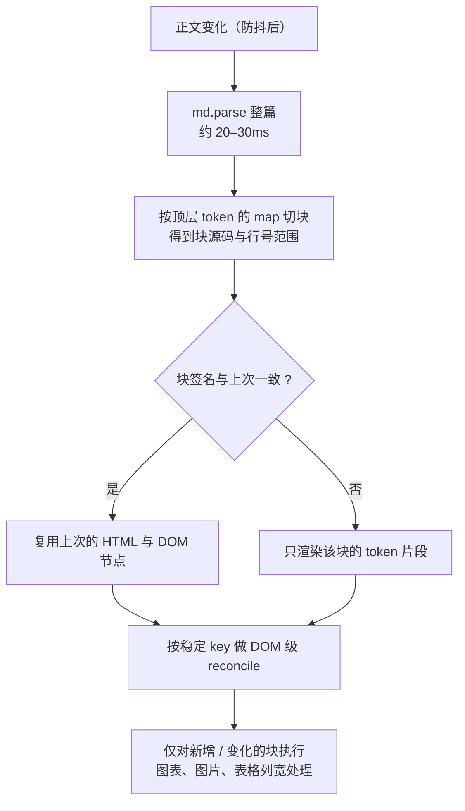
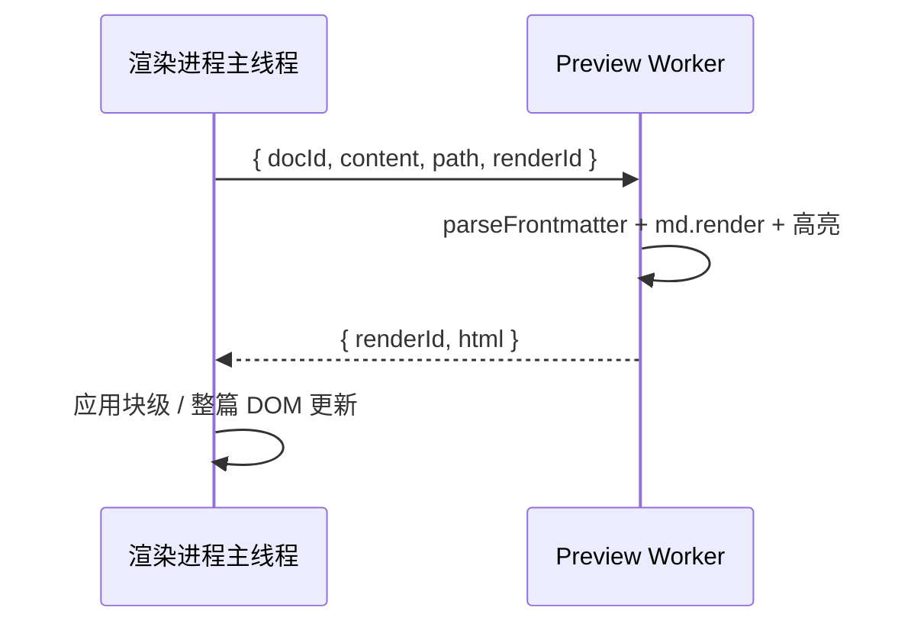

# 预览渲染后续优化计划（增量渲染与 Worker 渲染）

> **状态：规划中，未开工。** 前置优化已完成：预览层复用、HTML / 图表缓存、输入防抖与大纲防抖（提交 `ec02493`、`4d0cee4`）。
> 文档定位：记录长文档下「停止输入后整篇预览重建」的后续优化方案、取舍与验收标准，供排期与评审使用。
> 最后核对：2026-11-12。

## 1. 背景与现状

### 1.1 已完成的优化

| 优化                                             | 效果                                  |
| ------------------------------------------------ | ------------------------------------- |
| 每个标签保留独立预览层，切标签只切换 `transform` | 切回已渲染标签约 400–450ms → 54–124ms |
| 预览 HTML 与图表 SVG 的 LRU 缓存                 | 切回不再执行 `md.render` 与图表绘制   |
| 正文输入 150ms 尾部防抖                          | 连续输入只在停顿后渲染一次            |
| 大纲解析 200ms 尾部防抖 + 按标签缓存             | 每次按键不再整篇 `parseHeadings`      |
| 输入路径只保留一次全文 `toString`                | 单次按键事件中位数 0–1ms              |

### 1.2 剩余问题

长文档（样例：307 KB / 14.8 万字符 / 91 张表 / 4 个图表）在停止输入后仍有一次明显停顿：

| 环节                               | 单次耗时（本机实测） | 执行位置       |
| ---------------------------------- | -------------------- | -------------- |
| `md.render` 整篇渲染               | 42–108ms             | 渲染进程主线程 |
| `innerHTML` 解析 + 样式重算 + 布局 | 110–200ms            | 渲染进程主线程 |
| 4 个图表重绘（源码未变时命中缓存） | 0–2ms                | 渲染进程主线程 |

合计约 150–300ms 的收尾任务，用户感知为「打完字后界面卡一下」。当前架构无法通过参数调整消除：`v-html` 只能整体替换，markdown-it 只能整篇渲染。

## 2. 目标与非目标

**目标**

1. 把「正文输入后的一次性收尾」压到 50ms 以内（以 1.2 节样例文档为准）；
2. 输入停顿后预览更新延迟不超过 200ms；
3. 滚动位置、表格列宽、图表缩放、搜索高亮、大纲锚点行为不回退；
4. 不改变用户可见的渲染结果（同一文档在优化前后生成的 HTML 语义一致）。

**非目标**

- 不做预览区虚拟滚动：滚动同步按容器比例换算，改为虚拟列表会重写同步模型；
- 不改 Markdown 渲染语义（插件、frontmatter、本地图片、Mermaid 识别保持现状）；
- 不优化 PDF / 图片导出链路（它们独立构建 HTML，不在本计划范围）。

## 3. 方案 A：增量渲染（优先）

### 3.1 思路

保留整篇 `md.parse`（约 20–30ms，可接受），但把「渲染 + DOM 替换」从整篇改为**按顶层块增量更新**：

关键点：

1. **块切分**：markdown-it 顶层 token 的 `token.map` 给出源码行范围；相邻 token 合并为「顶层块」。frontmatter 表格作为第 0 块单独处理。
2. **块签名**：用「token 类型序列 + 源码片段哈希」作为块 key。未变化的块直接复用上一版 HTML 与 DOM 节点。
3. **DOM reconcile**：优先让 Vue 接管，把预览改为 `v-for` 的块列表（每块一个 `v-html`），key 使用块签名。Vue 的 keyed diff 会自动复用未变化的节点，只替换变化的块；这比手写 DOM diff 更可控。
4. **锚点与依赖**：`heading-N` 是渲染顺序序号，标题增删会改变后续标题的 id，因此受影响的标题块必须重新渲染；Mermaid 块只有源码变化时才重绘。
5. **引用式链接**：markdown-it 的 reference definition 是文档级的。检测到定义类 token（`reference_definition`）变化时，整篇失效重渲染，避免块级缓存产生过期链接。

### 3.2 预期收益

| 环节                | 现状      | 方案 A                    |
| ------------------- | --------- | ------------------------- |
| 整篇 `md.parse`     | 20–30ms   | 20–30ms（保留）           |
| 渲染                | 42–108ms  | 只渲染变化块，通常 < 10ms |
| DOM 替换 / 样式重算 | 110–200ms | 只更新变化块，通常 < 20ms |
| 合计                | 150–300ms | **30–60ms**               |

### 3.3 风险与对策

| 风险                                                | 对策                                                   |
| --------------------------------------------------- | ------------------------------------------------------ |
| 块边界与 HTML 嵌套不匹配（列表、引用、HTML 块跨块） | 以 markdown-it 顶层 token 为单位，而不是按行或空行切分 |
| 标题 id 顺序变化导致锚点错位                        | 标题增删时把后续标题块标记为失效                       |
| 引用定义、脚注类文档级语法                          | 检测到文档级 token 变化时整篇重渲染                    |
| 表格列宽按「表头哈希」记忆，块替换后需重注入        | 只对新增 / 变化的表格执行 `applyTableWidths`           |
| 搜索高亮 Range 失效                                 | 块更新后重新调用 `applyPreviewSearch(false)`           |
| Mermaid 包装节点被块替换                            | 只重绘源码变化的图表块，其余保留 DOM                   |

### 3.4 实施步骤

1. 抽出「顶层块切分 + 块签名」纯函数（`utils/preview-blocks.ts`），补 `*.spec.ts`：标题增删、引用定义、嵌套列表、HTML 块、frontmatter；
2. 预览模板改为 `v-for` 块列表 + 每块 `v-html`，保留现有 `markit-preview-layer` 结构与滚动占位；
3. 块级收尾：只对变化块执行 `resolveHtmlImages` / `applyTableWidths` / `renderDiagrams`；
4. 大纲复用同一份块切分结果，减少一次 `parseHeadings`；
5. 以 1.2 节样例文档与 `e2e` 长文档用例做回归。

**工作量评估：M（约 3–5 个开发日，含测试与回归）。**

## 4. 方案 B：Worker 渲染（方案 A 之后的下一步）

### 4.1 思路

把 markdown-it 渲染与 highlight.js 高亮移到 Web Worker：

- Worker 只负责「源码 → HTML 字符串」，不接触 DOM；
- 主线程收到 HTML 后仍需要做 DOM 更新；因此**方案 B 建议与方案 A 一起使用**，否则只是把 42–108ms 的渲染移走，DOM 的 110–200ms 仍在；
- 渲染结果按「文档 id + 内容 + 路径」缓存，切标签、撤销重做不重复计算；
- 每次请求带 `renderId`，主线程只接受最新结果，丢弃过期返回。

### 4.2 预期收益

在方案 A 的基础上，再省去主线程的 `md.render`（通常 10ms 以内，整篇失效时 40–100ms）。收益主要集中在「整篇失效」（引用定义变化、外部刷新、初次打开）场景。

### 4.3 风险与对策

| 风险                                       | 对策                                                                             |
| ------------------------------------------ | -------------------------------------------------------------------------------- |
| Worker 内无法使用 DOM（图片解析、Mermaid） | Worker 只输出 HTML；图片改写、图表渲染仍在主线程                                 |
| 插件与导出管线需要同一套规则               | Worker 与主线程共用 `utils/markdown.ts` 工厂，Worker 入口单独构建                |
| 300KB 内容与 200KB HTML 的结构化克隆       | 预计 1–3ms 量级（落地前实测）；字符串无法 transfer，仍需复制                     |
| 过期渲染覆盖新内容                         | `renderId` 单调递增，只接受最新结果                                              |
| 开发模式 HMR 与 Worker 生命周期            | 使用 Vite `?worker` 导入，组件卸载时终止 Worker                                  |
| 包体积                                     | Worker 单独打包 markdown-it / highlight.js，约 200–300KB（按需加载，不影响首屏） |

### 4.4 实施步骤

1. 新增 `workers/preview-render.worker.ts`，复用 `createMarkdownRenderer` 与 `parseFrontmatter`；
2. 主线程 `usePreviewRenderer` 封装请求 / 取消 / 缓存；
3. 与方案 A 的块级 reconcile 对接；
4. 补齐 Worker 失败时的降级路径（回退主线程渲染）。

**工作量评估：M（约 2–4 个开发日）。**

## 5. 备选与暂不实施的方向

| 方向                                      | 结论     | 原因                                                                                                          |
| ----------------------------------------- | -------- | ------------------------------------------------------------------------------------------------------------- |
| `content-visibility: auto` 跳过视口外布局 | 暂不实施 | 实测首次布局 121 → 63ms，但滚动高度变为估算值，会破坏按内容锚点恢复滚动位置与滚动同步比例；需要先重写滚动模型 |
| 预览区虚拟滚动                            | 暂不实施 | 与按比例滚动同步、表格列宽、图表自适应冲突，改造面大于收益                                                    |
| 逐键增量统计字数                          | 暂不实施 | 收益约 0.5ms/键，需要处理多选区、撤销、外部替换等边界，风险高于收益（D17）                                    |
| 预览 DOM 子树跨标签复用                   | 已否决   | 重挂已渲染子树仍需完整布局（实测 121ms），与重建 DOM 相当                                                     |

## 6. 验收标准

方案 A：

- [ ] 1.2 节样例文档输入停顿后的收尾任务 ≤ 60ms（CDP trace 中 `EventDispatch` 与随后的 `UpdateLayoutTree` / `Layout` 之和）；
- [ ] 滚动位置往返误差 ≤ 20px，与当前 `e2e/app.spec.ts` 的断言一致；
- [ ] 表格列宽、图表、搜索高亮、大纲锚点、页内锚点在块更新后行为不变；
- [ ] 引用定义变化时整篇重渲染，链接目标正确；
- [ ] `npm run lint` / `typecheck` / `test` / `build` 通过，相关 e2e 通过。

方案 B：

- [ ] 主线程不再执行 markdown-it 渲染（trace 中无对应 `FunctionCall`）；
- [ ] Worker 渲染失败的文档自动回退主线程并给出 `console.warn`；
- [ ] 快速连续输入时不会出现旧结果覆盖新结果；
- [ ] 初次打开、引用定义变化、外部刷新三种整篇失效场景均有回归用例。

## 7. 度量方法

1. 使用 CDP `Tracing`（categories：`devtools.timeline,blink,v8`）记录一次输入 / 切换操作，统计 `EventDispatch`、`FunctionCall`、`UpdateLayoutTree`、`Layout` 的耗时；
2. 样例文档固定为 1.2 节的 307 KB 手册，避免用短文档得出乐观结论；
3. 每个方案落地前后各记录 3 次，取中位数；同时记录内存占用（预览层 + 缓存）。

## 8. 相关文档

- [编辑器与预览](../编辑与预览/编辑器与预览.md)（7.8 渲染性能与多层预览）
- [技术决策与已知限制](../架构与契约/技术决策与已知限制.md)（D16、D17）
- [测试与质量保障](../工程与质量/测试与质量保障.md)
