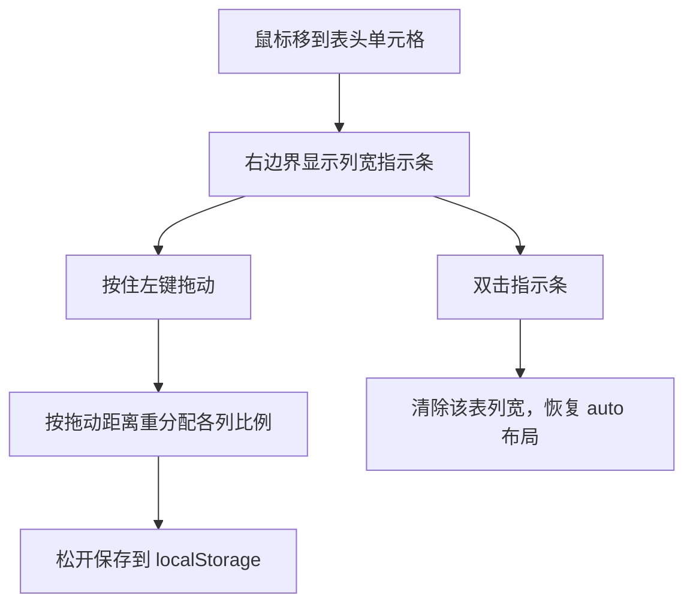
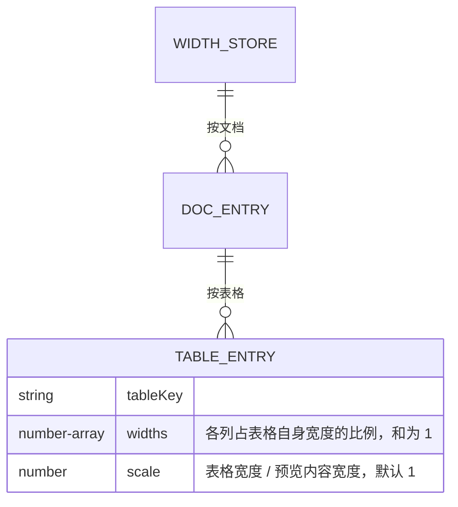
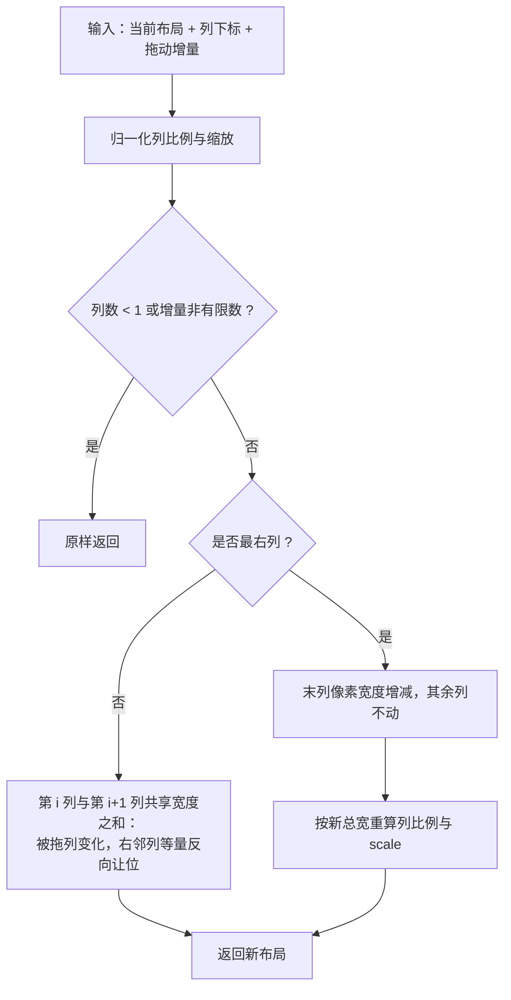
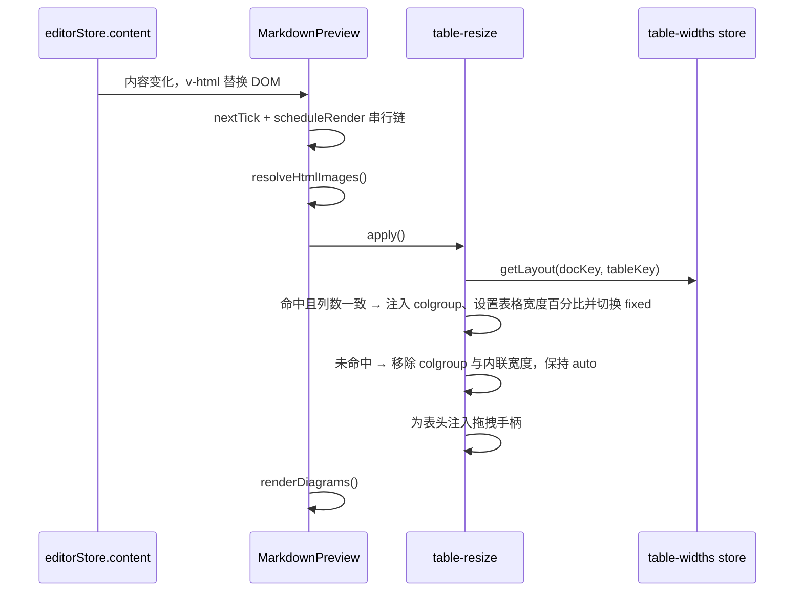

# 预览表格列宽调整

> 本文描述预览模式下拖动表格列宽的设计与实现约定。列宽属于**视图层状态**，不写回 Markdown 源文件，因此不改变文档的 GitHub 规范（GFM）兼容性。
>
> - 适用版本：`1.5.0`
> - 最后核对：2026-11-09
> - 相关文档：[编辑器与预览](./编辑器与预览.md)、[主题样式与布局](./主题样式与布局.md)、[PDF 导出](./PDF导出.md)

## 1. 背景与目标

GFM 表格语法只支持对齐（`:---` / `:---:` / `---:`），**没有列宽概念**。当表格列数较多或某列内容过长时，markdown-it 输出的 `<table>` 由浏览器按 `table-layout: auto` 自动分配宽度，常见结果是首列过窄、内容频繁换行，阅读体验差。

目标：

1. 在预览区把鼠标放在表头右边界，可直接拖动调整该列宽度；
2. 宽度按文档记忆，切换标签、重启应用后仍生效；
3. **不修改 Markdown 源文本**，文件在 GitHub、VS Code、Typora 等工具中渲染结果不变；
4. 未拖动过的表格保持现有 `auto` 布局，升级后视觉零变化。

非目标：

- 不写回文件（不生成 HTML `style`、不增加私有语法、不写入注释）；
- 不改变 PDF 导出（见第 7 节）；
- 不支持键盘调整、不支持整表拖动换列。

## 2. 兼容性边界

| 方案                                         | 载体                  | 对 GFM 的影响              | 采用 |
| -------------------------------------------- | --------------------- | -------------------------- | ---- |
| 宽度仅存界面层（localStorage）               | `markit-table-widths` | 无，`.md` 文件保持纯 GFM   | ✅   |
| 写回 Markdown（内联 HTML / 注释 / 私有扩展） | `.md` 文件            | 破坏，其他工具渲染结果不同 | ❌   |

实现只操作渲染后的 DOM：为表格注入 `<colgroup>` 并切换 `table-layout: fixed`。markdown-it 的 token 流、表格对齐标记、主题 CSS 均不改动。

## 3. 交互设计



| 操作                 | 行为                                                                            |
| -------------------- | ------------------------------------------------------------------------------- |
| 悬停表头             | 单元格右边界出现 2px 指示条（`opacity: 0.35`）                                  |
| 拖动内部边界         | 指针改为 `col-resize`；被拖列与右侧相邻列等量反向让位，其余列不动，表格总宽不变 |
| 拖动最右列边界       | 其余列像素宽度不变，只有最后一列增减，表格总宽度随之变化                        |
| 松开                 | 写入 localStorage，当前会话立即生效                                             |
| 双击手柄             | 删除该表存档并恢复自动宽度                                                      |
| 编辑文档             | 每次重渲染后按存档重新应用，不丢失                                              |
| 列数被修改           | 存档列数与当前列数不一致时忽略存档，回退自动宽度                                |
| 内容变化导致表格重建 | 同列数时按「表头内容 + 重名序号」重新匹配，宽度继续生效                         |

拖动规则按边界位置区分：

- **内部边界**（第 `i` 列与第 `i+1` 列之间，`i < n-1`）：第 `i` 列变宽或变窄，第 `i+1` 列等量反向吸收，其余列保持原有宽度；两列之和不变，表格总宽不变。这样拖动某一列时不会牵动整张表的所有列；
- **最右列边界**：其余列的像素宽度保持不变，只有最后一列增减，表格总宽度随之增大或缩小。总宽超出预览区可视宽度时出现横向滚动条，回到可视范围内后滚动条消失。

除两列合计确实容纳不下两个最小宽度外，任何一列都不会低于最小宽度（见 5.1）。

## 4. 表标识

每次预览重渲染都会替换整棵 DOM 子树，不能靠 DOM 引用保存宽度，必须用**稳定的表标识**：

```text
tableKey = hash(规范化表头文本) + (同名序号 > 0 ? '-' + 序号 : '')
docKey   = 已保存文档取 normalizePath(path)，未保存文档取 untitled:<标签id>
```

规则：

1. 表头文本做空白折叠、首尾去空格、小写后拼接，再用 djb2 变体散列成 base36；
2. 同一文档中表头完全相同（哈希相同）的表格，按出现顺序追加序号 `-1`、`-2`…区分；
3. 表标识**只看表头**，正文增删不影响；但修改表头文字会让该表失去记忆（回退自动宽度）；
4. `docKey` 复用 [`normalizePath`](../src/renderer/src/utils/path.ts)：正斜杠归一化，Windows 下小写；
5. 文件另存为 / 改名后 `docKey` 变化，旧存档不再命中（已知限制，见第 8 节）。

## 5. 数据模型



存储键：`markit-table-widths`，值为 JSON：

```json
{
  "d:/docs/guide.md": {
    "1a2b3c": { "widths": [0.5, 0.2, 0.3], "scale": 1 },
    "1a2b3c-1": { "widths": [0.25, 0.25, 0.5], "scale": 1.2 }
  }
}
```

- `widths` 是各列相对**表格自身宽度**的比例（0–1，和为 1），渲染时换算为列百分比；`scale` 是表格总宽相对**预览内容宽度**的缩放，未拖动最右列时为 `1`（即 `width: 100%`）；
- 两者都保存比例而非像素：窗口缩放、预览宽度切换时等比缩放；
- 旧版本只保存 `number[]` 的列宽数组，载入时按 `{ widths, scale: 1 }` 迁移，不丢历史调整；
- 写入发生在拖动结束（`pointerup`）与双击复位时，不做节流；
- 载入时逐项校验：非数组、空数组、含非有限数或非正数一律丢弃该条；
- `untitled:` 开头的未保存文档只在内存有效，不写入磁盘；
- 全部读写集中在 [`stores/table-widths.ts`](../src/renderer/src/stores/table-widths.ts)，符合「localStorage 键集中在 store 中读写」的约定。

### 5.1 宽度重分配算法

纯函数位于 [`utils/table-resize.ts`](../src/renderer/src/utils/table-resize.ts)：



- 最小宽度以**像素**定义：`MIN_COLUMN_PX = 40`，拖动时用表格当前像素宽度换算为比例（`resolveMinColumnRatio`）。固定占比（原 `0.06`）会让预览越宽、窄列的绝对下限越大——1200px 宽的表格下「序号」列被卡在 72px，因此改为像素下限，宽预览下也能压到约 40px；无法取得表格宽度时回退为 `MIN_COLUMN_RATIO = 0.06`；
- 内部边界由 `resizeAdjacentColumnWidths` 处理：只调整第 `i` 与第 `i+1` 列，两列之和不变；若像素下限让两列无法同时满足（两列合计不足 `2 × 40px`），下限收敛为合计的一半；
- 最右列边界由 `resizeLastColumn` 处理：先按增量求出末列的新像素宽度，再换算成新的表格总宽与 `scale`，其余列的比例同步重算以保持像素宽度不变；
- `scale` 的合法区间为 `MIN_TABLE_SCALE = 0.1` 到 `MAX_TABLE_SCALE = 3`（表格最宽为预览内容宽度的 3 倍），避免异常输入把表格拉得过大或过小；
- 函数不修改入参，返回新对象；拖动过程中始终以**按下时的快照**为基准计算总增量，避免逐帧累积误差。

## 6. 渲染时序



关键约定：

1. `apply()` 必须在 `v-html` 更新之后执行，且位于图表渲染之前（图表替换的是 `<pre>`，不影响表格）；
2. 每次渲染都**先判定再应用**：存档缺失或列数不符时主动移除 `colgroup`、内联宽度与 `markit-table-resized`，避免切换文档后延续上一份文档的列宽；
3. 手柄每次都随 DOM 重建，用 `:scope > .markit-col-resizer` 判重，不会重复插入；
4. 拖动过程中若内容被编辑导致表格节点被替换，`table.isConnected === false`，立即结束本次拖动，不写入无效数据；
5. 拖动监听挂在 `window` 上（`pointermove` / `pointerup` / `pointercancel`），不依赖手柄元素存活。

## 7. 与其他能力的关系

| 能力                      | 交互                                                                                  |
| ------------------------- | ------------------------------------------------------------------------------------- |
| 预览主题                  | 仅补充 `table-layout: fixed` 与单元格换行规则；主题的边框、内边距、配色不变           |
| 预览宽度（固定 / 自适应） | 列宽与表格缩放都按比例保存，容器变宽变窄时自动等比缩放                                |
| 最右列放大                | 表格可宽于预览内容，超出可视范围的部分通过预览区横向滚动条查看；缩回后滚动条消失      |
| 滚动同步                  | 表格变高后预览区高度变化，`useScrollSync` 按比例映射，无需改动                        |
| frontmatter 表格          | 通过 `.frontmatter-table` / `.frontmatter-block` 排除，不注入手柄                     |
| 原始 HTML `<table>`       | 有 `<thead>` 时同样生效；无表头则跳过                                                 |
| 链接分流 / 图表缩放       | 手柄的 `pointerdown` 与 `dblclick` 均 `stopPropagation`，不触发预览点击分流与图表双击 |
| 主题切换                  | DOM 未重建（仅样式变更），存档继续生效                                                |
| PDF 导出                  | **不生效**：PDF 走独立管线，仍为默认列宽（第一版取舍，见第 8 节）                     |

## 8. 已知限制

1. **PDF 不保留列宽**：导出 HTML 由 `usePdfExport` 单独生成，不读取本存档。若后续需要，可在导出时把比例换算为 `<colgroup>` 内联；
2. **另存为 / 重命名后失效**：`docKey` 变化，旧存档不迁移；
3. **修改表头文字后失效**：表标识基于表头哈希，改字等于换成另一张表；
4. **拖拽中编辑会中断**：预览重渲染会替换表格节点，拖动自动结束；已应用的宽度保留；
5. **存档无清理机制**：删除文档后其条目仍留在 localStorage。单条体积很小（每表 < 1KB），暂不做回收；
6. **不可键盘操作**：手柄无 tabindex 与方向键支持，属于纯指针交互；
7. **最右列放大受屏幕限制**：拖动距离受指针可移动范围约束，表格总宽最大为预览内容宽度的 3 倍（`MAX_TABLE_SCALE`），超出后不再变宽。

## 9. 测试与验收

### 9.1 单元测试

[`utils/table-resize.spec.ts`](../src/renderer/src/utils/table-resize.spec.ts) 覆盖：

| 用例                                                         | 守护的风险                                      |
| ------------------------------------------------------------ | ----------------------------------------------- |
| 比例归一化（含全零、空数组、负数）                           | 除零、NaN 进入样式                              |
| 内部边界拖动只改变相邻两列，其余列不动                       | 拖一列时整张表的列都跟着变                      |
| 内部边界两列同时触底 / 合计不足两倍像素下限                  | 出现负宽度、某列被压成 0 或无法拖动             |
| 最右列拖动后其余列像素宽度不变、总宽与 `scale` 按增量变化    | 末列拖拽牵动左侧所有列，或总宽计算漂移          |
| 最右列达到最小宽度 / 最大缩放时停止                          | 出现 0 宽度或无限放大                           |
| 像素下限换算（宽表格可低于 6%、宽度非法时回退）              | 宽预览下窄列被固定占比撑开，或除零得到 Infinity |
| 列数不足、下标越界、增量非有限数                             | 边界输入导致异常                                |
| 表头哈希的大小写 / 空白归一、重复表头加序号                  | 编辑正文后列宽错位到别的表                      |
| 存档校验：新结构、旧数组迁移、非法条目丢弃、`scale` 越界夹取 | 损坏或旧版 localStorage 数据进入渲染            |

### 9.2 手工验证

1. `npm run dev` 启动，写一张 3 列表格，拖动中间列左右各一次，确认只有相邻列反向让位、其余列与表格总宽不变；
2. 拖动最右列边界加宽 / 收窄，确认左侧各列宽度不变、表格总宽随之变化，加宽超出预览宽度时出现横向滚动条；
3. 继续输入正文并新增行，确认列宽不丢失；
4. 切换标签再切回，确认列宽恢复；
5. 重启应用，确认列宽持久化；
6. 双击手柄，确认恢复自动布局；
7. 切换预览主题、调整预览宽度，确认列宽比例保持；
8. 打开含 frontmatter 的文档，确认「文档信息」表格没有拖拽手柄；
9. 在拖动过程中编辑正文，确认拖动安全结束、无报错。

## 10. 相关文件

| 文件                                                                                                                  | 说明                                                     |
| --------------------------------------------------------------------------------------------------------------------- | -------------------------------------------------------- |
| [src/renderer/src/utils/table-resize.ts](../src/renderer/src/utils/table-resize.ts)                                   | 比例归一化、相邻列重分配、末列缩放、表标识哈希、存档校验 |
| [src/renderer/src/utils/table-resize.spec.ts](../src/renderer/src/utils/table-resize.spec.ts)                         | 纯函数单元测试                                           |
| [src/renderer/src/composables/usePreviewTableResize.ts](../src/renderer/src/composables/usePreviewTableResize.ts)     | DOM 注入、拖拽交互、渲染后重新应用                       |
| [src/renderer/src/stores/table-widths.ts](../src/renderer/src/stores/table-widths.ts)                                 | `markit-table-widths` 读写与校验                         |
| [src/renderer/src/components/preview/MarkdownPreview.vue](../src/renderer/src/components/preview/MarkdownPreview.vue) | 渲染链中调用 `apply()`、手柄与表格样式                   |
